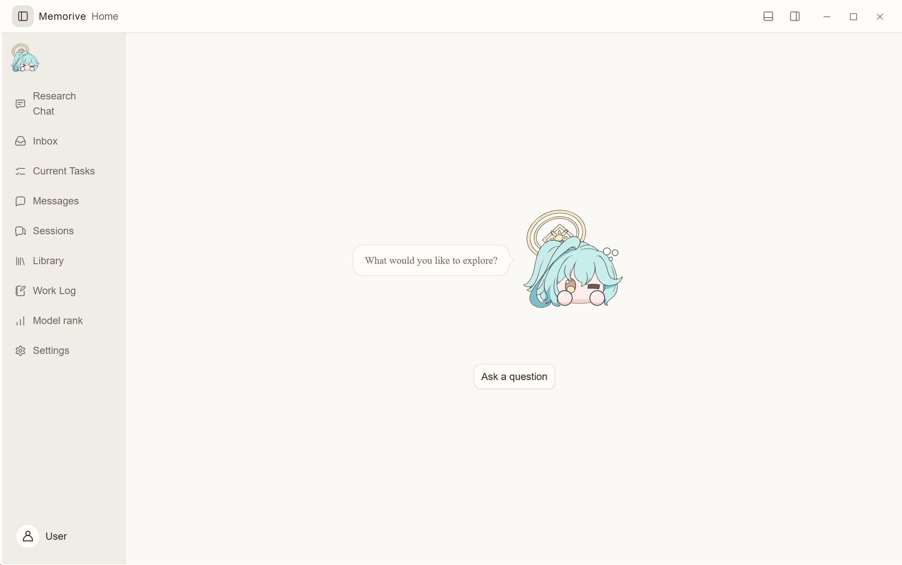
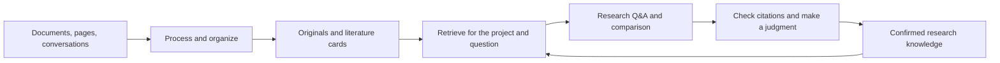

# Memorive

Read papers with AI, and check every citation against the original.

Memorive (memo for short) is a Windows desktop app for students and researchers who work with papers. Import papers, web pages and AI chat logs: Memorive keeps the originals and builds a literature card for each paper with its methods, key numbers, findings and limitations. Ask questions across several papers at once, then open any citation in the answer to jump to the page and passage it came from. Conclusions you have checked go into your knowledge base, ready for later questions.

Connect a cloud model API, a command-line tool you are already signed in to (such as Codex or Claude Code), or a local model through Ollama. Your library and settings are stored on your own computer.

[English](README.md) · [中文](README.zh-CN.md) · [日本語](README.ja.md)

### [⬇ Download Memorive for Windows](https://github.com/KuchinashiYume/Memorive/releases/download/v1.03/Memorive-Setup-1.03-x64.exe)

**v1.03 · Windows 10 22H2 / Windows 11 · x64 · about 205 MB**

**First time here? Download the installer above.** Plugins and the Test Console are optional extras.

[Which file should I download?](#download-guide) · [Downloads](https://github.com/KuchinashiYume/Memorive/releases) · [User guide](memorive_desktop/product/desktop/help/en-US/manual-text.md) · [Design](memorive_desktop/product/desktop/help/en-US/design.md) · [Issues](https://github.com/KuchinashiYume/Memorive/issues)

## New in v1.03

- **Read papers with an AI agent.** The new memo-research Skill lets agents such as Codex or Claude Code read papers for you. Papers an agent has already converted can go straight into Research Q&A, or you can hand the current question to an agent and get its cited answer back in the same conversation. The Skill also works on its own.
- **Test Console** now comes in English, Chinese and Japanese, with a review-and-results view and shareable summaries.
- Includes the settings-save fix from v1.02.01.

Back up your data and settings before upgrading, then use the installer or the complete portable package.

## Home at a glance

## What can you do?

### Read: bring your materials in

Import materials through the Inbox, check the preview, then decide when to process them. You can also add PDF, images, Word, Markdown or TXT straight into Research Q&A and ask about them right away. Session Management gathers your local Codex and Claude Code records and conversations captured in the browser, and refines them into key points, decisions and next steps.

### Organize: turn materials into evidence you can trace

Each processed document gets a literature card and an analysis report. The card records the research subject, methods, key numbers, findings and limitations; the analysis offers an interpretation built on them. Read both side by side with the original in the Library. If a processing step fails, retry from that step.

### Verify: ask questions and check each citation

Select several papers in one conversation to compare their methods, sample conditions, results and limitations. Retrieval starts with the conversation's attachments and can widen to the whole project. Every citation in an answer opens the passage, page or line it came from, so you can see at once whether a number or conclusion is supported.

### Retain: keep what you have checked

Research Q&A suggests conclusions worth saving. Once you have checked a conclusion's claim, scope and citations, confirm it into your knowledge base, and later questions can draw on it. Research records, refined conversations and daily, weekly or monthly reports help you review your progress.

### Models and tools

| Feature | What it does |
| --- | --- |
| Model connections | Official APIs, OpenAI-compatible endpoints, relay services, signed-in CLIs, and local services such as Ollama. |
| Per-step models | Use different models for embeddings, card generation, analysis, review and periodic reports. |
| Browser companion | Save web pages, or capture AI conversations from supported sites. |
| Obsidian and Zotero | Connect notes and library items to Memorive, search and ask about them, and write results back to your notes. |
| Model rankings | Compare public capability scores, prices and update dates, then try candidates on your own materials. |
| Usage and costs | See requests, tokens and costs by time and model; costs are marked actual, estimated or unknown. |

## Download and install

### Download guide

| What you need | Download |
| --- | --- |
| **Install Memorive (recommended)** | [Memorive-Setup-1.03-x64.exe](https://github.com/KuchinashiYume/Memorive/releases/download/v1.03/Memorive-Setup-1.03-x64.exe) |
| Run without installing | [Complete portable package](https://github.com/KuchinashiYume/Memorive/releases/download/v1.03/Memorive-Portable-1.03-x64.zip); extract the whole folder |
| Documentation | [PDF, Markdown and web guides in three languages](https://github.com/KuchinashiYume/Memorive/releases/download/v1.03/Memorive-1.03-Documentation.zip) |
| Obsidian / Zotero companions | [Obsidian](https://github.com/KuchinashiYume/Memorive/releases/download/v1.01/Memorive-Obsidian-Companion.zip) · [Zotero](https://github.com/KuchinashiYume/Memorive/releases/download/v1.01/Memorive-Zotero-Companion.xpi) · [Installation guide](memorive_desktop/integrations/README.en.md) |
| Research Skill (standalone) | [memo-research Skill v0.2.0](https://github.com/KuchinashiYume/Memorive/releases/download/v1.03/Memorive-Research-Skill-0.2.0.zip) |
| Test Console (for developers) | [Installer](https://github.com/KuchinashiYume/Memorive/releases/download/v1.03/Memorive-Test-Console-Setup-1.03-x64.exe) · [Portable](https://github.com/KuchinashiYume/Memorive/releases/download/v1.03/Memorive-Test-Console-Portable-1.03-x64.zip) |
| Source code | [v1.03 desktop source](https://github.com/KuchinashiYume/Memorive/releases/download/v1.03/Memorive-1.03-desktop-source.zip) (includes the Test Console and research Skill) · [Third-party sources](https://github.com/KuchinashiYume/Memorive/releases/download/v1.02/Memorive-1.02-third-party-sources.zip) (about 592 MB) |
| Checksums | [SHA256SUMS.txt](https://github.com/KuchinashiYume/Memorive/releases/download/v1.03/SHA256SUMS.txt) |

Other files and earlier versions are on the [Releases page](https://github.com/KuchinashiYume/Memorive/releases). The "Source code" archives that GitHub adds contain source only; use the installer above to install.

### Installation

1. You need **Windows 10 22H2 or later, or Windows 11 (x64)**.
2. Run the installer. It is not code-signed, so Windows may show a security prompt. To check the file, run `Get-FileHash -Algorithm SHA256 .\Memorive-Setup-1.03-x64.exe` in PowerShell and compare the result with `SHA256SUMS.txt`.
3. The installer's System Check lists any missing components (.NET Framework 4.8, WebView2 Runtime, Visual C++ v14 x64); install what it asks for. Python is bundled.
4. Choose the program and data folders. After the first launch, confirm where your files are stored in Settings → Documents and external viewing.

### Connect a model

One connection is enough to start:

- **API:** in Settings → Model services and API, enter the provider's protocol, endpoint, model ID and key, verify the connection, then assign it to tasks.
- **CLI:** install and sign in to the tool in a terminal, then select and verify it in Settings → CLI integration.
- **Local model:** start your local model server, then detect it or enter its address in Settings → Local models and load the model list.

Different steps need different abilities; reading images, for example, needs a model that supports images. Bring your own API credits or CLI subscription.

### First steps

1. In Workflow model mapping, choose a model for each step.
2. Drop a paper you know well into the Inbox and follow it in Current Tasks.
3. In the Library, compare its literature card and analysis with the original.
4. Start a research conversation, add papers and ask a focused question, such as “Compare the methods, sample conditions and main limitations of these two papers, citing each source.”
5. Open the citations to check them against the original, then add the conclusion to your knowledge base.

If a task fails, look at the error on the step that failed. Changing the embedding model may require rebuilding indexes; back up before moving your data folder.

Illustrated guides are in Settings → About and version → User documentation. You can also read [installation and first setup](memorive_desktop/INSTALL.md) and the [text guide](memorive_desktop/product/desktop/help/en-US/manual-text.md).

## How it works

Originals, versions and generated results are stored separately. Search helps you find content; the original is what you check against. See the [design document](memorive_desktop/product/desktop/help/en-US/design.md) for details and the [build instructions](memorive_desktop/BUILDING.md) to build from source.

## Data and costs

Your materials and settings are stored locally. Cloud models, web reading and external retrieval send the relevant content to the service you choose; for sensitive materials, use a local model. Save API keys in the credential field, and make sure screenshots, logs and exports are free of keys before you share them.

Costs are recorded as actual, estimated or unknown; your provider's bill shows what you actually paid. Check OCR results, model answers and citations against the originals yourself.

## Modify and test

You are free to modify Memorive. The included **Test Console** starts your own build in a temporary data space so you can reproduce issues and check behavior. The temporary data is cleared when you finish, and your real data stays untouched. Tests that call real models ask for your permission first and may incur charges.

[Console guide](memorive_console/README.en.md) · [中文](memorive_console/README.md) · [日本語](memorive_console/README.ja.md). The console code is also AGPL-3.0-only; see the [console notice](memorive_console/NOTICE.txt) for icon rights.

## How this project is developed

All of the project's own code was written and iterated by **OpenAI Codex** and **Anthropic Claude Code**. The project initiator defined the requirements and product design and carried out testing and acceptance.

## Acknowledgements

The document-structure work draws on Datalab's [Marker](https://github.com/datalab-to/marker), especially its document blocks and its preservation of tables and layout. Thank you to its authors and contributors. Memorive can also use Marker for local parsing; its runtime and model weights are set up separately, under their own licenses.

## License and character artwork

Project code uses [AGPL-3.0-only](LICENSE); see the [licensing scope](memorive_desktop/LICENSING.md). The maintainer hopes it will be used for personal learning, research and non-commercial purposes; this is a request only, and the license terms stay as written.

Some character images are AI-assisted fan creations inspired by Blue Archive. Memorive is an unofficial personal project, unaffiliated with Nexon, Nexon Games, or Yostar. Underlying characters, names, and marks belong to their respective rights holders. Desktop-pet images, expressions, and character icons are covered by the [asset notice](memorive_desktop/ASSET_NOTICE.md); dependencies are listed in the [third-party notices](memorive_desktop/THIRD_PARTY_NOTICES.md).

## Feedback and contact

Report questions, bugs and feature ideas in [GitHub Issues](https://github.com/KuchinashiYume/Memorive/issues), with your Memorive version and the steps to reproduce; remove API keys and private content from screenshots and logs. For private feedback, security issues or artwork-rights questions, email [kuchinashiyume01@Gmail.com](mailto:kuchinashiyume01@Gmail.com).

## Version history

- **[v1.02.01](https://github.com/KuchinashiYume/Memorive/releases/tag/v1.02.01)**: settings-save and version-parsing fixes.
- **[v1.02](https://github.com/KuchinashiYume/Memorive/releases/tag/v1.02)**: literature discovery, AI Updates, custom CLI connections, multilingual output, conversation archiving and signed updates.
- **[v1.01](https://github.com/KuchinashiYume/Memorive/releases/tag/v1.01)**: first public release, with document processing, research Q&A and model connections.
