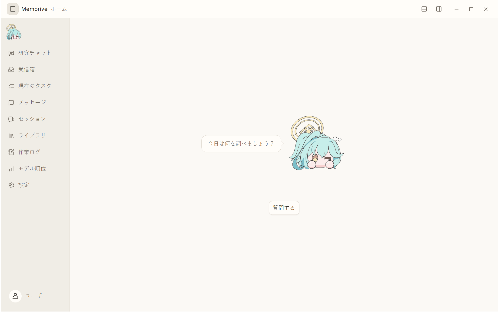
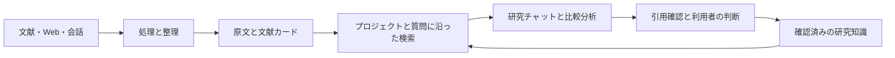

# Memorive

AI と文献を読み、すべての引用を原文で確かめる。

Memorive（略称 memo）は、学生や研究者のための Windows デスクトップアプリです。論文、Web ページ、AI との会話を取り込むと、原本を保存したうえで、論文ごとに研究方法・主要な数値・結果・限界をまとめた文献カードを作ります。複数の論文にまとめて質問でき、回答の引用を開くと原文の該当ページと段落に移動します。確認した結論は知識として保存され、次の質問でも活用できます。

モデルは、クラウドの API、サインイン済みの Codex や Claude Code などのコマンドラインツール、Ollama などのローカルモデルから選べます。資料と設定はお使いの PC に保存されます。

[English](README.md) · [中文](README.zh-CN.md) · [日本語](README.ja.md)

### [⬇ Memorive Windows 版をダウンロード](https://github.com/KuchinashiYume/Memorive/releases/download/v1.03/Memorive-Setup-1.03-x64.exe)

**v1.03 · Windows 10 22H2 / Windows 11 · x64 · 約 205 MB**

**初めての方は、上のインストーラーをダウンロードしてください。** プラグインとテストコンソールは必要に応じて追加できます。

[どのファイルを選べばよいですか？](#ダウンロードガイド) · [ダウンロード](https://github.com/KuchinashiYume/Memorive/releases) · [利用ガイド](memorive_desktop/product/desktop/help/ja-JP/manual-text.md) · [設計文書](memorive_desktop/product/desktop/help/ja-JP/design.md) · [問題の報告](https://github.com/KuchinashiYume/Memorive/issues)

## v1.03 の新機能

- **AI エージェントと一緒に文献を読む**：memo-research Skill を追加しました。Codex や Claude Code などのエージェントが処理した論文を、研究チャットにそのまま追加できます。いまの質問をエージェントに渡すと、引用付きの回答が元の会話に戻ってきます。Skill は単体でも使えます。
- **テストコンソール**が日本語・英語・中国語に対応し、レビュー・結果画面と共有用の要約を追加しました。
- v1.02.01 の設定保存の修正を含みます。

更新の前に資料と設定をバックアップし、インストーラーまたは完全なポータブル版で更新してください。

## ホーム画面

## できること

### 読む：資料を取り込む

資料は受信箱から取り込み、プレビューを確認してから処理するタイミングを決めます。研究チャットには PDF、画像、Word、Markdown、TXT を直接追加でき、すぐに質問できます。ローカルの Codex・Claude Code の記録やブラウザーで取得した会話は、会話管理でまとめて扱い、要点・決定・次の作業に精錬できます。

### 整理する：原文に戻れる根拠にする

資料を処理すると、文献カードと分析レポートができます。カードには研究対象、方法、重要な数値、結果、限界をまとめ、分析レポートはそれをもとに解釈を示します。どちらもライブラリで原文と並べて読めます。処理の途中で失敗したら、そのステップから再試行できます。

### 確かめる：質問し、引用を一つずつ確認する

一つの会話に複数の文献を選び、方法、標本条件、結果、限界を比較できます。検索は会話の添付資料から始まり、必要に応じてプロジェクト全体へ広げられます。回答の引用を開くと原文の該当箇所、ページ、行が表示され、数値や結論に裏付けがあるかをすぐに確かめられます。

### 残す：確認した知識を次に生かす

研究チャットは保存する価値のある結論を提案します。主張、適用範囲、引用を確認してから知識に追加すると、後の質問で活用できます。研究記録、会話の精錬結果、日次・週次・月次レポートで進み具合を振り返れます。

### モデルとツール

| 機能 | 内容 |
| --- | --- |
| モデル接続 | 公式 API、OpenAI 互換エンドポイント、中継サービス、ログイン済みの CLI、Ollama などのローカルサービス。 |
| 処理ごとのモデル | ベクトル化、カード生成、分析、検証、定期レポートにそれぞれ別のモデルを使えます。 |
| ブラウザー拡張 | Web ページを保存したり、対応サイトの AI との会話を取得したりできます。 |
| Obsidian・Zotero | ノートや文献アイテムを Memorive につなぎ、検索や質問をして、結果をノートに書き戻せます。 |
| モデルランキング | 公開されている性能指標、価格、更新日時で候補を比べ、自分の資料で試せます。 |
| 使用量と費用 | 期間とモデルごとにリクエスト、トークン、費用を確認できます。費用は実額・推定・不明で表示します。 |

## ダウンロードとインストール

### ダウンロードガイド

| 用途 | ダウンロード |
| --- | --- |
| **Memorive をインストール（おすすめ）** | [Memorive-Setup-1.03-x64.exe](https://github.com/KuchinashiYume/Memorive/releases/download/v1.03/Memorive-Setup-1.03-x64.exe) |
| インストールせずに使う | [完全なポータブル版](https://github.com/KuchinashiYume/Memorive/releases/download/v1.03/Memorive-Portable-1.03-x64.zip)（フォルダー全体を展開） |
| 利用ガイド | [3 言語の PDF・Markdown・Web 版](https://github.com/KuchinashiYume/Memorive/releases/download/v1.03/Memorive-1.03-Documentation.zip) |
| Obsidian / Zotero プラグイン | [Obsidian](https://github.com/KuchinashiYume/Memorive/releases/download/v1.01/Memorive-Obsidian-Companion.zip) · [Zotero](https://github.com/KuchinashiYume/Memorive/releases/download/v1.01/Memorive-Zotero-Companion.xpi) · [インストール方法](memorive_desktop/integrations/README.ja.md) |
| 研究 Skill（単体利用） | [memo-research Skill v0.2.0](https://github.com/KuchinashiYume/Memorive/releases/download/v1.03/Memorive-Research-Skill-0.2.0.zip) |
| テストコンソール（開発者向け） | [インストール版](https://github.com/KuchinashiYume/Memorive/releases/download/v1.03/Memorive-Test-Console-Setup-1.03-x64.exe) · [ポータブル版](https://github.com/KuchinashiYume/Memorive/releases/download/v1.03/Memorive-Test-Console-Portable-1.03-x64.zip) |
| ソースコード | [v1.03 デスクトップソース](https://github.com/KuchinashiYume/Memorive/releases/download/v1.03/Memorive-1.03-desktop-source.zip)（テストコンソールと研究 Skill を含む） · [第三者コンポーネントのソース](https://github.com/KuchinashiYume/Memorive/releases/download/v1.02/Memorive-1.02-third-party-sources.zip)（約 592 MB） |
| チェックサム | [SHA256SUMS.txt](https://github.com/KuchinashiYume/Memorive/releases/download/v1.03/SHA256SUMS.txt) |

そのほかのファイルや過去の版は [Releases ページ](https://github.com/KuchinashiYume/Memorive/releases)にあります。GitHub が自動で付ける Source code のアーカイブはソースのみなので、インストールには上のインストーラーをお使いください。

### インストール

1. **Windows 10 22H2 以降、または Windows 11（x64）**が必要です。
2. インストーラーを実行します。コード署名がないため、Windows のセキュリティ警告が表示されることがあります。ファイルを確認するには、PowerShell で `Get-FileHash -Algorithm SHA256 .\Memorive-Setup-1.03-x64.exe` を実行し、`SHA256SUMS.txt` の値と比べてください。
3. システムチェックで不足しているコンポーネント（.NET Framework 4.8、WebView2 Runtime、Visual C++ v14 x64）が表示されたら、案内に従って入れてください。Python は同梱されています。
4. プログラムとデータの保存先を選びます。初回起動後、「設定 → 文書と外部表示」で資料の保存先を確認してください。

### モデルを接続する

まずは一つ接続すれば始められます。

- **API**：「設定 → モデルサービスと API」で提供元のプロトコル、アドレス、モデル ID、キーを入力し、接続を検証してから処理に割り当てます。
- **CLI**：ターミナルでツールをインストールしてログインし、「設定 → CLI 接続」で選択して検証します。
- **ローカルモデル**：ローカルのモデルサーバーを起動し、「設定 → ローカルモデル」で自動検出するかアドレスを入力して、モデル一覧を読み込みます。

処理によって必要な能力は異なります。たとえば画像の読み取りには、画像に対応したモデルが必要です。API の利用枠や CLI の契約はご自身でご用意ください。

### はじめての使い方

1. 「現在の処理フローのモデル設定」で、各処理のモデルを選びます。
2. よく知っている論文を受信箱に追加し、「現在のタスク」で進み具合を見ます。
3. ライブラリで、文献カードと分析レポートを原文と見比べます。
4. 研究の会話を作って論文を追加し、具体的に質問します。例：「この二つの論文の方法、標本条件、主な限界を、出典を示して比較してください」。
5. 引用を開いて原文と照らし合わせ、問題がなければ結論を知識に追加します。

タスクが失敗したときは、失敗したステップのエラーを確認してください。ベクトルモデルを変えると、索引の再構築が必要になることがあります。データの保存先を移す前には、バックアップを取ってください。

図解ガイドは「設定 → バージョン情報 → 利用文書」から開けます。[インストールと初期設定](memorive_desktop/INSTALL.md)と[テキスト版ガイド](memorive_desktop/product/desktop/help/ja-JP/manual-text.md)もご覧ください。

## 仕組み

原文、版、生成した結果は分けて保存します。索引は内容を探すために使い、確認するときは原文を基準にします。詳しくは[設計文書](memorive_desktop/product/desktop/help/ja-JP/design.md)、ソースからのビルドは[ビルド手順](memorive_desktop/BUILDING.md)をご覧ください。

## データと費用

資料と設定はローカルに保存されます。クラウドモデル、Web 取得、外部検索を使うと、関連する内容が選んだサービスへ送信されます。機密性の高い資料には、ローカルモデルを使ってください。API キーは認証情報欄に保存し、スクリーンショット、ログ、エクスポートを共有する前に、キーが含まれていないか確認してください。

費用は実額・推定・不明に分けて記録します。実際の支払額は、提供元の請求書でご確認ください。OCR の結果、モデルの回答、引用は、原文と照らし合わせてご自身で確認してください。

## 改良とテスト

Memorive のコードは自由に変更できます。付属の**テストコンソール**は、自分でビルドした Memorive を一時データ領域で起動し、不具合の再現や動作の確認に使えます。終了すると一時データは削除され、普段のデータはそのまま残ります。実際にモデルを呼び出すテストは事前に許可を求め、費用が発生することがあります。

[コンソールの使い方](memorive_console/README.ja.md) · [中文](memorive_console/README.md) · [English](memorive_console/README.en.md)。コンソールのコードも AGPL-3.0-only です。アイコンの権利については[コンソールの声明](memorive_console/NOTICE.txt)をご覧ください。

コード自体を変更するときは、まず[開発ガイド](memorive_desktop/DEVELOPING.md)（英語）をご覧ください。コードの各部分の場所、そのまま動かせる例、変更後に実行するテストをまとめています。

## 開発について

プロジェクト独自のコードは、すべて **OpenAI Codex** と **Anthropic Claude Code** が書き、改良を重ねてきました。企画者は要件定義、製品設計、テストと受け入れ確認を担当しています。

## 謝辞

文献の構造解析では、Datalab の [Marker](https://github.com/datalab-to/marker)、特に文書のブロック分割と、表やレイアウトの構造を保つ考え方を参考にしました。作者と貢献者の皆様に感謝します。Memorive では Marker によるローカル解析も選べます。実行環境とモデルの重みは別途用意し、それぞれのライセンスに従ってください。

## ライセンスとキャラクター素材

プロジェクトのコードには [AGPL-3.0-only](LICENSE) を適用します。[適用範囲](memorive_desktop/LICENSING.md)をご確認ください。作者は、個人の学習・研究と非商用での利用を願っています。これはお願いであり、ライセンスの条件はそのままです。

一部のキャラクター画像は『ブルーアーカイブ』を参考に AI を用いて制作した二次創作です。Memorive は個人による非公式プロジェクトで、Nexon、Nexon Games、Yostar との関係はありません。原キャラクター、名称、標章などの権利は各権利者に帰属します。デスクトップペット、表情、キャラクターアイコンには[素材に関する声明](memorive_desktop/ASSET_NOTICE.md)を別途適用します。依存コンポーネントは[第三者に関する説明](memorive_desktop/THIRD_PARTY_NOTICES.md)をご覧ください。

## フィードバック・お問い合わせ

使い方の質問、不具合、機能の提案は [GitHub Issues](https://github.com/KuchinashiYume/Memorive/issues) へお寄せください。Memorive のバージョンと再現手順を添え、スクリーンショットやログからは API キーと個人的な内容を取り除いてください。非公開のご連絡、セキュリティや素材の権利に関するお問い合わせは、[kuchinashiyume01@Gmail.com](mailto:kuchinashiyume01@Gmail.com) までお送りください。

## 過去のバージョン

- **[v1.02.01](https://github.com/KuchinashiYume/Memorive/releases/tag/v1.02.01)**：設定保存と版番号認識の修正。
- **[v1.02](https://github.com/KuchinashiYume/Memorive/releases/tag/v1.02)**：文献探索、AI近況、カスタム CLI、多言語生成、会話アーカイブ、署名付き更新。
- **[v1.01](https://github.com/KuchinashiYume/Memorive/releases/tag/v1.01)**：最初の公開版。文献処理、研究チャット、モデル接続を提供。
