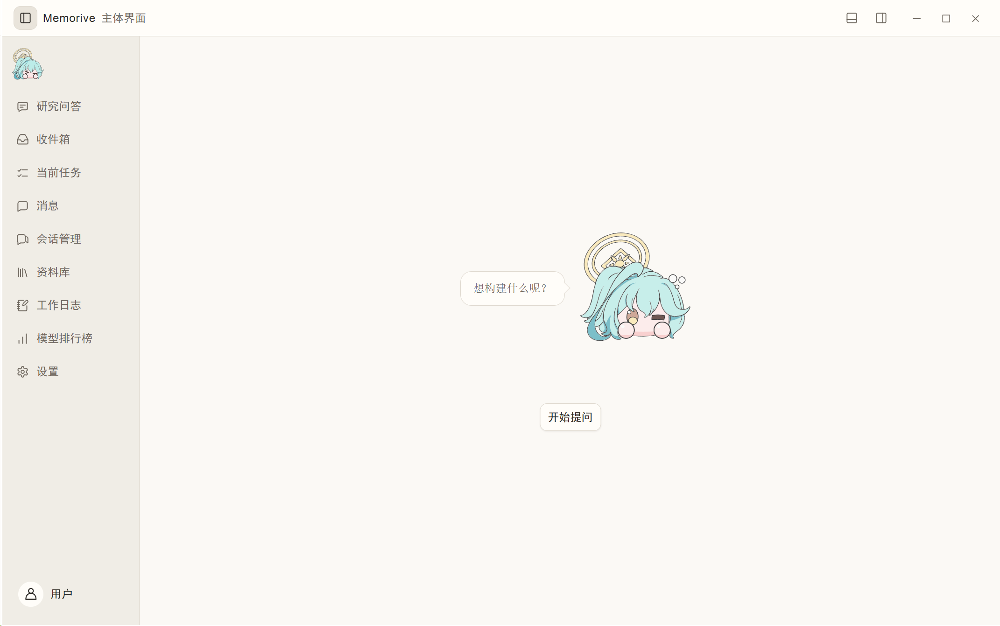
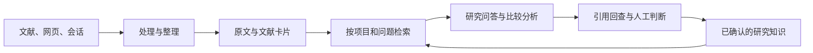

# Memorive

用 AI 读文献，每条引用都能回到原文核对。

Memorive（简称 memo）是一款面向学生和研究者的 Windows 桌面应用。把论文、网页和 AI 对话导入进来，它会保留原件，并为每篇论文整理一张文献卡片，记下研究方法、关键数据、主要发现和局限。你可以同时向几篇文献提问，点开回答里的任意一条引用，就能跳到原文对应的页和段落。核对过的结论存进知识库，之后提问时可以接着用。

模型可以接云端 API、本机已登录的 Codex、Claude Code 等命令行工具，或者 Ollama 这类本地模型。资料和设置都保存在你自己的电脑上。

[English](README.md) · [中文](README.zh-CN.md) · [日本語](README.ja.md)

### [⬇ 点击下载 Memorive Windows 版](https://github.com/KuchinashiYume/Memorive/releases/download/v1.03/Memorive-Setup-1.03-x64.exe)

**v1.03 · Windows 10 22H2 / Windows 11 · x64 · 约 205 MB**

**第一次使用，下载上方的安装包就行。** 配套插件和测试控制台可以按需另装。

[我应该下载哪个文件？](#下载选择指南) · [下载与版本](https://github.com/KuchinashiYume/Memorive/releases) · [使用指南](memorive_desktop/product/desktop/help/zh-CN/manual-text.md) · [设计文档](memorive_desktop/product/desktop/help/zh-CN/design.md) · [问题反馈](https://github.com/KuchinashiYume/Memorive/issues)

## v1.03 新内容

- **和 AI Agent 一起读文献**：新增 memo-research Skill。Codex、Claude Code 等 Agent 处理过的论文，可以直接加进研究问答；也可以把当前问题交给 Agent 去读，它带引用的回答会回到原来的对话。Skill 也能单独使用。
- **测试控制台**支持中、英、日三种语言，新增审核与结果页面，可以生成分享用的摘要。
- 包含 v1.02.01 的设置保存修复。

升级前请先备份资料和设置，再用安装包或完整便携包升级。

## 主页一览

## 可以做什么

### 读：把资料带进来

资料从收件箱导入，先看预览，再决定什么时候处理。研究问答里也能直接添加 PDF、图片、Word、Markdown 或 TXT，加进来就能提问。本机 Codex、Claude Code 的对话记录和浏览器采集的对话，可以在会话管理里统一整理，精炼成要点、决定和待办。

### 理：整理成能回查的证据

每篇资料处理完，会得到一张文献卡片和一份分析报告。卡片记录研究对象、方法、关键数值、结果和局限，分析报告在此基础上给出解读，两者都可以在资料库里和原文对照着读。处理中哪一步出错，就从哪一步重试。

### 证：提问，并逐条查引用

一次对话可以选入多篇文献，比较它们的方法、样本条件、结果和局限。检索从对话附件开始，需要时可以扩大到整个项目。回答里的每条引用都能点开，看到原文的片段、页码或行号，数字和结论有没有依据，一对照就清楚。

### 存：留给下一次研究

研究问答会提出值得保存的结论。你检查过它的主张、适用范围和引用后，再确认加入知识库，之后提问时就能带上这些背景。研究记录、会话精炼和日报、周报、月报帮你回顾进展。

### 模型与工具

| 功能 | 说明 |
| --- | --- |
| 模型接入 | 官方 API、OpenAI 兼容接口、中转服务、本机已登录的 CLI，以及 Ollama 等本地服务。 |
| 按步骤分配模型 | 向量化、卡片生成、分析、审核和定期报告可以各用不同的模型。 |
| 浏览器插件 | 保存网页，或采集支持的网站上的 AI 对话。 |
| Obsidian 与 Zotero | 把笔记和文献条目接入 Memorive，检索、提问，并把结果写回笔记。 |
| 模型排行榜 | 对比公开的能力指标、价格和更新时间，挑出候选后用自己的资料试一试。 |
| 用量与费用 | 按时间和模型查看请求、Token 和费用，费用分实际、估算和未知三类。 |

## 下载与安装

### 下载选择指南

| 用途 | 下载 |
| --- | --- |
| **安装 Memorive（推荐）** | [Memorive-Setup-1.03-x64.exe](https://github.com/KuchinashiYume/Memorive/releases/download/v1.03/Memorive-Setup-1.03-x64.exe) |
| 免安装使用 | [完整便携包](https://github.com/KuchinashiYume/Memorive/releases/download/v1.03/Memorive-Portable-1.03-x64.zip)，解压整个文件夹后运行 |
| 使用文档 | [中英日三语 PDF、Markdown 与网页版](https://github.com/KuchinashiYume/Memorive/releases/download/v1.03/Memorive-1.03-Documentation.zip) |
| Obsidian / Zotero 插件 | [Obsidian 插件](https://github.com/KuchinashiYume/Memorive/releases/download/v1.01/Memorive-Obsidian-Companion.zip) · [Zotero 插件](https://github.com/KuchinashiYume/Memorive/releases/download/v1.01/Memorive-Zotero-Companion.xpi) · [安装说明](memorive_desktop/integrations/README.md) |
| 研究 Skill（单独使用） | [memo-research Skill v0.2.0](https://github.com/KuchinashiYume/Memorive/releases/download/v1.03/Memorive-Research-Skill-0.2.0.zip) |
| 测试控制台（开发者用） | [安装版](https://github.com/KuchinashiYume/Memorive/releases/download/v1.03/Memorive-Test-Console-Setup-1.03-x64.exe) · [便携版](https://github.com/KuchinashiYume/Memorive/releases/download/v1.03/Memorive-Test-Console-Portable-1.03-x64.zip) |
| 源码 | [v1.03 桌面源码](https://github.com/KuchinashiYume/Memorive/releases/download/v1.03/Memorive-1.03-desktop-source.zip)（含测试控制台和研究 Skill） · [第三方依赖源码](https://github.com/KuchinashiYume/Memorive/releases/download/v1.02/Memorive-1.02-third-party-sources.zip)（约 592 MB） |
| 校验文件 | [SHA256SUMS.txt](https://github.com/KuchinashiYume/Memorive/releases/download/v1.03/SHA256SUMS.txt) |

其他文件和旧版本在 [Releases 页面](https://github.com/KuchinashiYume/Memorive/releases)。GitHub 自动附带的 Source code 压缩包只含源码，安装请用上面的安装包。

### 安装

1. 需要 **Windows 10 22H2 及以上，或 Windows 11（x64）**。
2. 运行安装包。安装包没有 Windows 代码签名，Windows 可能弹出安全提示。想确认文件完好，可以在 PowerShell 里运行 `Get-FileHash -Algorithm SHA256 .\Memorive-Setup-1.03-x64.exe`，和 `SHA256SUMS.txt` 里的值对比。
3. 安装向导的“系统检查”会列出缺少的组件（.NET Framework 4.8、WebView2 Runtime、Visual C++ v14 x64），按提示装好即可。Python 已经内置。
4. 选好程序目录和数据目录。第一次启动后，到“设置 → 文档与外部查看”确认资料的存放位置。

### 连接模型

先配好一种就可以开始：

- **API**：在“设置 → 模型服务与 API”填入服务商的协议、地址、模型 ID 和 Key，验证通过后分配用途。
- **CLI**：先在终端里安装并登录工具，再到“设置 → CLI 接入”选中它并验证。
- **本地模型**：启动本地模型服务后，在“设置 → 本地模型”自动检测或填写地址，读取模型列表。

不同步骤对模型的要求不同，比如读图需要支持图像的模型。API 额度或 CLI 订阅需要自己准备。

### 第一次使用

1. 在“当前流程模型映射”里给各个步骤选好模型。
2. 把一篇熟悉的论文拖进收件箱，在“当前任务”里看处理进度。
3. 在资料库里对照原文，看看文献卡片和分析报告是否准确。
4. 新建研究对话，添加文献，提一个具体的问题，例如“比较这两篇文献的方法、样本条件和主要局限，分别注明出处”。
5. 点开引用核对原文，确认无误后，把结论加入知识库。

任务失败时，先看出错那一步的原因。更换向量模型后可能需要重建索引；移动资料目录前请先备份。

完整的图文教程在“设置 → 关于与版本 → 使用文档”，也可以阅读[安装与首次配置](memorive_desktop/INSTALL.md)和[纯文字使用指南](memorive_desktop/product/desktop/help/zh-CN/manual-text.md)。

## 工作原理

原文、版本和生成的结果分开保存。检索用来找内容，核对时以原文为准。详细设计见[设计文档](memorive_desktop/product/desktop/help/zh-CN/design.md)，从源码构建见[构建说明](memorive_desktop/BUILDING.md)。

## 数据与费用

资料和设置保存在本地。使用云端模型、网页读取或外部检索时，相关内容会发给你选择的服务，敏感资料可以改用本地模型。API Key 请通过凭据栏保存，分享截图、日志或导出记录前，先确认里面没有 Key。

费用按实际、估算和未知三类记录，实际花费以服务商账单为准。OCR 结果、模型回答和引用，请自己对照原文核对。

## 修改与测试

Memorive 的代码可以自由修改。仓库附带的**测试控制台**会在临时数据空间里启动你构建的 Memorive，用来复现问题、检查功能。测试结束后临时数据会被清除，你的正式数据保持原样；需要调用真实模型的测试会先征求你的同意，可能产生费用。

[控制台使用说明](memorive_console/README.md) · [English](memorive_console/README.en.md) · [日本語](memorive_console/README.ja.md)。控制台代码同样采用 AGPL-3.0-only，图标的权利说明见[控制台声明](memorive_console/NOTICE.txt)。

要修改代码本身，请先看[开发说明](memorive_desktop/DEVELOPING.md)（英文）：各部分代码在哪里、一个能直接运行的示例，以及改动后要跑哪些测试。

## 开发方式

项目自身的代码全部由 **OpenAI Codex** 和 **Anthropic Claude Code** 编写和迭代，项目发起者负责需求、产品设计和测试验收。

## 致谢

文献结构化解析参考了 Datalab 的 [Marker](https://github.com/datalab-to/marker)，尤其是文档分块和保留表格、版面结构的思路，感谢作者和贡献者。Memorive 也可以选用 Marker 做本地解析，运行环境和模型权重需要另行配置，并遵循各自的许可。

## 许可与角色素材

项目代码采用 [AGPL-3.0-only](LICENSE)，适用范围见[许可说明](memorive_desktop/LICENSING.md)。作者希望它用于个人学习、研究和非商业用途；这只是倡议，许可证条款保持不变。

部分角色图像是参考《Blue Archive》的 AI 辅助二次创作。Memorive 是非官方的个人项目，与 Nexon、Nexon Games 和 Yostar 均无关联；原角色、名称和标识的权利归各自权利人所有。桌宠、表情和角色图标另见[素材声明](memorive_desktop/ASSET_NOTICE.md)，第三方组件见[第三方说明](memorive_desktop/THIRD_PARTY_NOTICES.md)。

## 反馈与联系

使用问题、错误报告和功能建议请提交到 [GitHub Issues](https://github.com/KuchinashiYume/Memorive/issues)，附上 Memorive 版本和复现步骤，并去掉截图和日志里的 API Key 和私人内容。私密反馈、安全问题或素材权利问题，请发邮件到 [kuchinashiyume01@Gmail.com](mailto:kuchinashiyume01@Gmail.com)。

## 历史版本

- **[v1.02.01](https://github.com/KuchinashiYume/Memorive/releases/tag/v1.02.01)**：设置保存与版本识别修复。
- **[v1.02](https://github.com/KuchinashiYume/Memorive/releases/tag/v1.02)**：文献发现、AI近况、自定义 CLI、多语言输出、问答归档和签名更新。
- **[v1.01](https://github.com/KuchinashiYume/Memorive/releases/tag/v1.01)**：第一个公开版本，提供文献处理、研究问答和模型连接。
