# Memorive Design Overview

*Design notes for users and contributors · v1.03 · October 2026*

Memorive links document processing, research Q&A, citation checking and knowledge reuse into one workflow. This document explains how data moves through the system, what each module does and how failures are handled, so you can see how Memorive builds research records you can trace back to the source. Field definitions, prompts, thresholds and test records live in each module's contract and run records; this document covers the design ideas.

## Design principles

**The researcher makes the final call.** AI understands, organizes, analyzes, recommends and reminds; the researcher confirms imports, admission, knowledge feedback and publication, and decides what happens to the original data. Automated tasks run only within the scope you have authorized.

**Your materials outlast the tools.** Originals, Markdown, literature cards, notes and decision records are kept for the long term, while models and software can be swapped at any time. Search indexes and on-screen views are generated from these materials and can always be rebuilt.

**Quality is judged on evidence.** Valid format, trustworthy content, complete extraction and traceable sources are checked separately. Key numbers, causal claims and anything headed for a paper are checked first. Ordinary gaps that can be handled on their own are kept and labelled; work stops only when core evidence fails or further output would mislead.

**Originals and every version are kept.** Materials stay in their original language, and translation happens only in the display layer. Every change creates a new version, and earlier content, review records and failures are kept.

**Build step by step.** First complete the smallest research loop, then add quality management, version management and research operations. Each new feature has a clear responsibility and clear dependencies.

## Architecture

Memorive has four main workflows:

- **Document processing:** import → document processing → evidence extraction builds a literature card → evidence review → knowledge admission → normal retrieval.
- **Research Q&A:** ask a question → evidence retrieval assembles a context pack → research analysis writes the answer → independent review where needed → your judgment.
- **Knowledge reuse:** research opportunities are found among admitted materials; conclusions you select become candidates through knowledge feedback and join the knowledge base once you confirm them.
- **External discovery:** literature discovery collects bibliographic records for the directions you set, and research recommendations organizes the candidates. Records and links can be saved to the library automatically; you add the full text, which then follows the normal processing and admission steps.

Originals and intermediate results can be saved at any time; materials need to be admitted before they enter normal retrieval and analysis. Research reports, data and logic checks, and app updates and maintenance are supporting modules alongside these workflows.

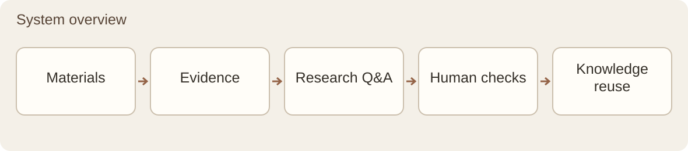

*Figure 1 · System overview*

### Modules

| Group | Modules | What they do |
| --- | --- | --- |
| Processing and analysis | Document processing, evidence extraction, evidence retrieval, research analysis | Turn source materials into citable evidence and analytical answers |
| Shared services | Evidence review, retrieval weighting, knowledge admission, model services | Content review, ranking, admission status and model calls |
| Checks | Data and logic checks, quality evaluation | Check numbers and logic, and monitor overall quality |
| Records and reuse | Knowledge feedback, runtime records, decision records, versions and lineage | Manage feedback candidates, and record runs, decisions and version relationships |
| Research operations | Research opportunities, research reports, literature discovery, research recommendations | Find tensions and gaps, report changes, and discover and recommend new papers |
| Desktop app | Application layer, task runner, app updates and maintenance | Connect the interface to the modules, run tasks, and manage installation and updates |

Each module has one job. Document processing owns conversion and OCR quality; evidence extraction owns extraction and structural checks; research analysis checks that citations come from the current materials; evidence review judges whether the evidence supports each claim; knowledge admission changes status based only on a request and its grounds. Technical retries belong to model services and the task runner, content repairs to evidence extraction and evidence review, and runtime records only records.

## How data is stored

### Two layers

The **source layer** holds originals and traceable text: the PDF or other original file, the converted RawMD, the cleaned CleanMD and the chunks. The original is the final reference, and converted text keeps its source positions and conversion record.

The **card layer** holds literature cards. Each card is a faithful summary of one paper, used for retrieval, comparison and checking. Personal notes, cross-paper summaries, analyses and feedback items are separate derived artifacts stored apart from the cards.

Vector indexes, field vectors and the desktop library form an **access layer**: they point to specific sources and versions and can always be rebuilt.

### Identity, sources and language

Each paper has a stable paper_id. Every saved artifact records its ID, content hash, schema version, source range, parent versions, run and execution settings; context packs and analyses that span several papers can have several parents.

Important card content is saved together with a source anchor: a chunk ID and a quotation from the original. The quotation must be found in the matching chunk; whether the summary itself is accurate is then decided in review. Identity or source information missing from older data is marked unknown, and Memorive does not guess it from file names or similar text.

Originals, converted text and cards stay in the source language. The interface, system messages and newly generated answers, suggestions and reports use the content language you choose; originals, citations, bibliographic records and earlier versions stay as they are. The language is fixed when a task starts, and caches are kept separate per language.

### Comparison context

To compare findings across papers, Memorive describes each finding with a common set of fields:

| Field | Meaning |
| --- | --- |
| Research Object | The subject, material, sample, text or system studied |
| Intervention / Factor | The factor or intervention examined |
| Comparator | The control or baseline |
| Method | Method, study design or analytical framework |
| Metric | Evaluation metric and what it means |
| Boundary Condition | Conditions and limits under which the conclusion holds |
| Scale / Context | Scale, setting and application context |
| Claim Type | Kind of conclusion: causal, correlational, mechanistic, performance, method validation and so on |

Each discipline only swaps in its own aliases for these fields. Evidence extraction fills them in, and research opportunities uses them to decide whether two findings are comparable.

## Document processing

### Document processing

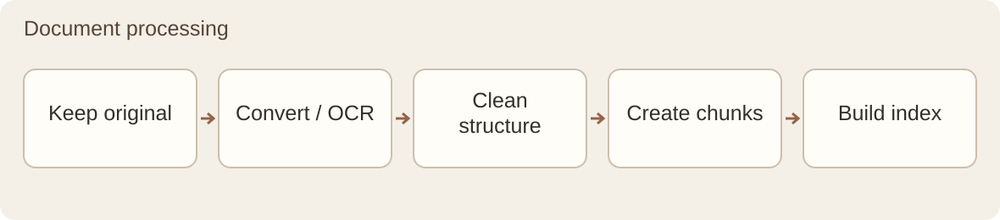

*Figure 2 · Document processing*

Document processing turns original documents, images or notes into an archived original, RawMD, CleanMD, chunks and a vector index, and records what happened at each step.

| Step | What it does |
| --- | --- |
| Import | Save the original with its source, identity, time and data-disposition label |
| Convert | Convert PDF and other files to RawMD, run OCR on problem pages as needed, and write a conversion report |
| Clean | Remove headers, footers, stray line breaks, merged columns and other layout noise with local rules |
| Chunk | Split by section, paragraph, table and caption, with stable chunk IDs |
| Embed | Create vectors with the chosen model and record the model and time |

Parsed output keeps paragraphs, tables, superscripts and subscripts, and page and line anchors. Local Marker parsing is available as an option.

**Page-level OCR.** Ordinary digital PDFs are parsed locally. OCR runs only on scanned pages, pages with almost no text, garbled pages or pages with broken structure: Memorive diagnoses the page locally, checks data-disposition rights, sends it to the chosen OCR model, compares the result with the original parse and then merges them. If one page fails, the other pages are kept and the missing page is marked.

**Note review.** Notes pause after conversion by default so you can check the transcription and formatting before processing continues.

**Rebuilding vectors.** Two models with the same name can produce different vector spaces, so dimensions, normalization and distance metric are checked before an old index is reused. When re-embedding, Memorive first confirms the new text can be produced, saves a snapshot of the old vectors, then clears and rebuilds; if the job stops partway, it restores from the snapshot.

Memorive currently supports 14 file formats. For JPEG, PNG and TIFF this step only checks the image itself and leaves any text in the image unread. Legacy Office files are converted with the Office installation on your computer, with macros and link updates disabled.

### Evidence extraction and literature cards

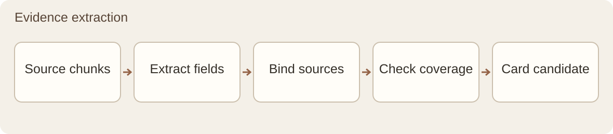

*Figure 3 · Evidence extraction*

Evidence extraction reads a paper's CleanMD and chunks and produces a literature card, supplementary extractions and a coverage record. Cards pass local checks first, then go to evidence review and knowledge admission.

The core fields of a card are the research question, subject, method, key results, the authors' conclusions, applicable conditions and source anchors. Supplementary extractions cover key data, comparison context, the limitations and future work the authors state, and optionally terms and citation relationships. Limitations of the study and the boundaries of a conclusion are recorded separately; personal ideas, critiques, hypotheses and cross-paper synthesis are kept outside the card.

| Rule | Extraction requirement |
| --- | --- |
| R1–R2 | Keep the strength of the authors' claims; keep multi-step processes and multi-group comparisons complete |
| R3–R4 | Extract numbers with their statistic type, stage, sample and range; state each metric's scope, denominator and control |
| R5–R6 | Attach the real applicable conditions to each conclusion; distinguish the research subject from samples used for characterization or testing |
| R7–R8 | Use terms as the authors define them; source anchors cover where the content was actually taken from |
| R9 | Extract everything the paper provides, and mark what it truly does not. When an obvious typo is interpreted from context, keep the original value, the reasoning and the change |

**Coverage.** Each required field is marked as present in the source, absent from the source, not applicable, an extraction gap, or not assessed. "Not found" and "not in the paper" are recorded separately.

**Generation and repair.** Before a card is written, Memorive checks its schema, types, source IDs, anchors and cross-field rules, and compares important quotations word for word with the original. When review finds fixable problems, the card gets one combined repair that changes only the affected fields. After a systemic failure, a new card and run are created, and the earlier failure is kept.

**Long papers.** Very long papers are extracted in segments and merged level by level; the result becomes visible only once it is complete.

## Retrieval and Q&A

### Evidence retrieval

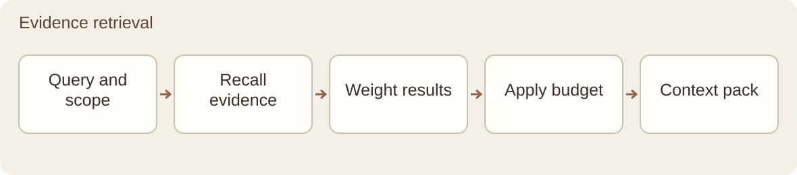

*Figure 4 · Evidence retrieval*

Evidence retrieval uses the question, the available materials and your weighting settings to assemble a context pack: a bounded set of evidence with its sources. It works in three steps: understand the question, recall candidates, then pack the context. Card and field signals locate the material first, and the original text is searched when needed; card anchors are only pointers, and the evidence text given to the model comes from the original chunks.

Packing balances the token limit, source diversity, the different aspects of the question and useful counterexamples. A table with its heading and footnotes in the same section, or directly adjacent paragraphs, can be supplied together. The context pack records which aspects of the question are covered and which are not, and carries each source's data-disposition limits through to analysis and review.

### Retrieval weighting

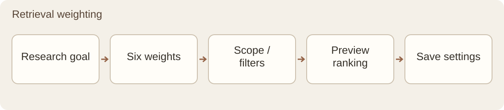

*Figure 5 · Retrieval weighting*

| Group | Weight | Meaning |
| --- | --- | --- |
| Relevance | SimilarityWeight | Vector similarity to the current question |
| Relevance | SemanticWeight | Field relevance computed for each aspect of the question |
| Authority and personal value | ManualWeight | Importance you set, with a stated reason |
| Authority and personal value | RuleWeight | Signals such as year, journal, citation count and publication type |
| Authority and personal value | NoteWeight | Your notes, annotations and other research traces |
| Authority and personal value | CitationWeight | How often and how you have cited the material in your research |

Final score = weighted relevance + derived factor × weighted authority. The coefficients can be adjusted for your research purpose.

**Down-weighting derived content.** Derived items such as cross-paper summaries, concept relationships and personal notes lose authority score only; their relevance is scored as usual. Cross-paper summaries are reduced the most and personal notes the least, so a second-hand summary does not crowd out the papers it is based on. Field vectors are created only for admitted cards and are stored separately from source-text vectors.

### Research analysis

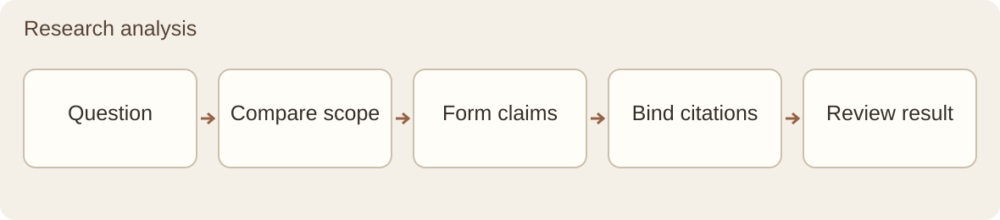

*Figure 6 · Research analysis*

Research analysis answers a question from the context pack in four parts: content supported by the literature, with citations; general AI background beyond the library; risks and uncertainties; and the places in the originals worth checking. When the materials do not cover the question well, it holds back the AI background and separately describes the study's own limitations, inconsistencies between sources and gaps in retrieval.

Research analysis checks that each citation comes from the current context pack. Citations that do not are moved out of the literature-supported section with a reason, and the rest of the answer is kept. Whether the evidence is sufficient and whether a claim goes too far is judged independently by evidence review. The answer offers viewpoints, evidence and structure; you draw the final conclusions.

**Answer versions.** Each answer records its sources, conditions and style settings. Regenerating creates a new branch: earlier branches are kept and stay out of the new context. Copying, switching versions and restoring drafts make no model calls. Conversations not opened for 30 days or with more than 100 messages are archived automatically, except pinned conversations and those in use.

### Research Skill

The memo-research Skill lets agents such as Codex or Claude Code read papers for you: the agent reads and drafts an answer, then checks the passages behind its key claims in one pass, and revises or flags as uncertain anything it cannot support.

Used on its own, the Skill keeps the original, RawMD and source.json for each paper. Select the source.json through the attachment button in Research Q&A, and Memorive checks the files and reuses them without converting again. You can also export a handoff package from the current conversation for an agent to continue reading; its answer comes back through the same conversation's attachment button, linked to the current question and material versions. Returned answers join the knowledge base only after you confirm them.

## Review and checks

### Evidence review

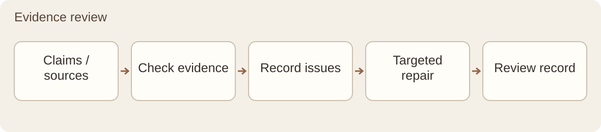

*Figure 7 · Evidence review*

Evidence review checks whether each claim in a card or analysis is supported by evidence. Cards and analyses each have their own review model, and review models come from a different model family than the models that generated the content.

**Card review.** A card gets one full review and is finished if no problems are found. If fixable problems are found, it gets one combined repair; only the changed parts are reviewed again, followed by a final overall check. Content is removed only when the error is clear, unique and separable, and removed content is archived; ambiguous cases go to you. A fully resolved card is marked complete; a card that is usable with some content omitted is marked "passed with omissions"; a card with unresolved core problems stays failed or waits for your decision.

**Analysis review.** Risk determines whether and how much of an analysis is reviewed, and skipped reviews record a reason. The review model sees only the claims and the cited evidence, not the reasoning used to generate them.

### Data and logic checks

Data and logic checks examine numeric relationships and internal logic in the text and tables of a paper. Reports show the source location, grounds, applicable conditions and coverage.

Rule-based checks first work out what percentages, ratios, units and statistics mean, then check explicit equations, ranges and numeric relationships. Where conditions are missing or values cannot be compared, the result is marked for review or as limited coverage; Memorive does not guess a denominator or a group. Model-based logic checks raise doubts that are grounded in the text. Rule results, model doubts and your own comments are stored separately, and a model's doubt stays a doubt until you confirm it.

The checks only produce reports: the original text stays unchanged, and the authors' intent is not inferred. They complement evidence review: these checks look at the data and logic themselves, while evidence review asks whether the evidence supports the extracted claims, and the two results are stored separately.

### Quality evaluation

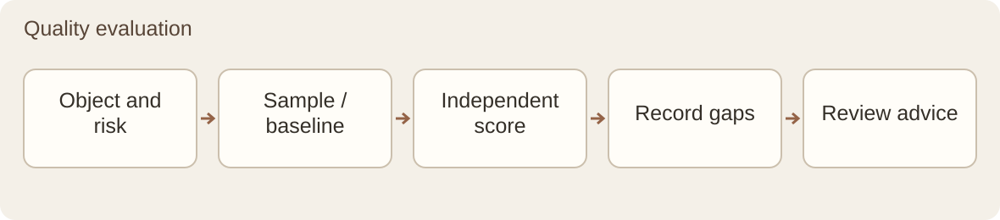

*Figure 8 · Quality evaluation*

Quality evaluation monitors quality through random sampling, risk-based sampling and fixed benchmark tests. Content with high weight, frequent citation, planned use in a paper or past review disagreements is sampled first. After a model, prompt or rule changes, the matching test pack is run again.

| Dimension | What it checks |
| --- | --- |
| Literal fidelity | Whether text, numbers, units and quotations match the source |
| Evidence coverage | Whether the evidence covers the claim's conditions, scope and comparators |
| Cross-artifact consistency | Whether cards, context packs, analyses, reviews and published items agree |
| Scientific plausibility | Whether statistics, units, samples, time and orders of magnitude make sense |
| Lineage freshness | Whether the upstream versions it relies on are compatible and current |

Each dimension is recorded separately, and unassessed dimensions are shown as such. Before numbers are compared, metric, unit, conditions, statistic type, time, sample and comparator are aligned; values that cannot be aligned are marked "not directly comparable". OCR output distinguishes body text from covers, tables of contents, headers and footers, and references, so numbers outside the body are kept apart from research results.

Benchmarks are maintained per task role. Each version fixes the complete questions, reference answers, scorer and manifest, and is reused across models; reference answers are used only for local scoring and are never shown to the model under test.

## Knowledge and records

### Knowledge admission

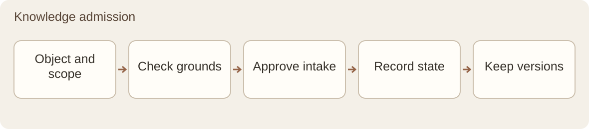

*Figure 9 · Knowledge admission*

A card has three admission states: pending, active and quarantined. Pending cards can be viewed and reviewed; only active cards enter normal retrieval, research-opportunity analysis and automatic feedback.

Knowledge admission changes state only on an explicit request with stated grounds. Each change creates an immutable event, stored by runtime records and linked by versions and lineage. Quality judgments, retries and repairs are handled by other modules.

### Knowledge feedback

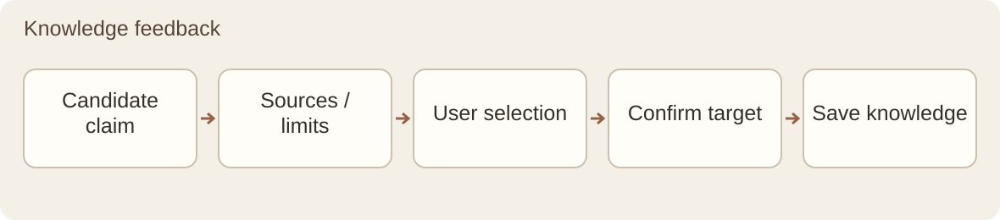

*Figure 10 · Knowledge feedback*

Annotations, judgments, hypotheses, stable concept relationships and cross-paper synthesis can all be fed back into the knowledge base. Your raw notes can be saved and organized into candidates automatically; each candidate joins the knowledge base only after you confirm it.

The flow is: select content → create a candidate with sources and reasons → check where it may go and what it would change → accept, edit, reject or defer → any required review and admission → save the version. A confirmed summary is still second-hand: it is down-weighted as derived content and carries less authority than the original papers.

### Versions and lineage

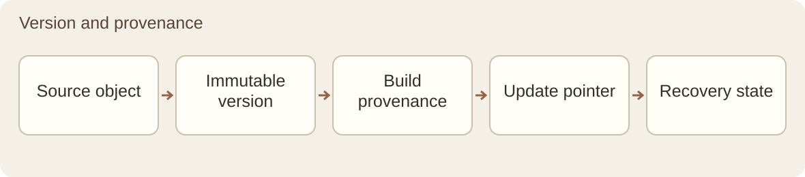

*Figure 11 · Versions and lineage*

Every artifact has an immutable ID, content hash, type, run, source range, creation time and one or more parent artifacts. Changing an original, text, card, feedback item or decision creates a new version, and the previous version is kept.

| Lifecycle | Meaning |
| --- | --- |
| Usage: active / cold / archive | Affects retrieval priority; separate from deletion |
| Version: current / superseded / history | Tracks replacements and history |
| Derived items: draft / current / superseded / historical | Version state of notes, summaries and other derived content |

Memorive decides whether an artifact is still compatible from its exact parent versions, schema and source range; when a parent is missing, the artifact is marked "lineage unknown". After a card is updated, analyses written from the old card are flagged as possibly out of date.

### Runtime and decision records

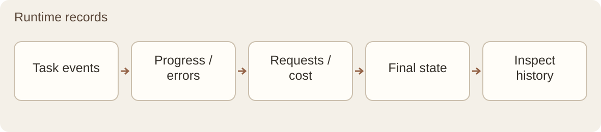

*Figure 12 · Runtime records*

Runtime records store events from every module and task: progress and errors for you, and module, object, stage, cause and evidence location for troubleshooting. They only record; judgments and repairs happen elsewhere.

| Record | Contents |
| --- | --- |
| Attempt records | The result, route and evidence of each actual call |
| Paper outcome records | The final result of each paper in each run; a redo starts a new run |
| Publication records | Publication requests, selected content, results and receipts |

Later successes are added as new records, and earlier failures are kept. External calls are recorded before sending (request identity, route, permissions and budget) and completed afterwards with the model actually returned, usage, cost and latency; fields missing from older data are marked unknown.

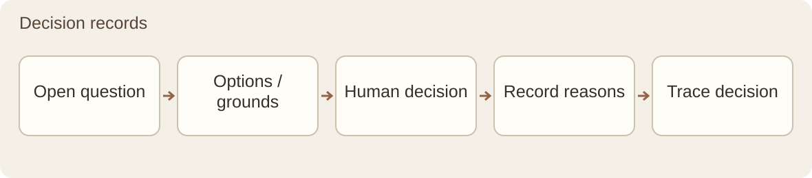

*Figure 13 · Decision records*

Decision records keep the background, alternatives, final choice, reasons for rejecting the alternatives, scope of impact and review date for important choices such as admitting a model, rolling back, re-embedding, publishing and withdrawing. Runtime records say what happened; decision records say why. When a decision changes, a new record is created and the original decision and reasoning are kept.

### Research reports

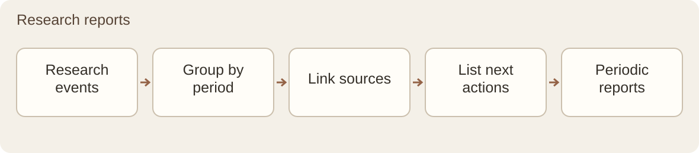

*Figure 14 · Research reports*

Research reports collect research events from runtime records, admission and version changes, and produce daily, weekly and monthly reports. Daily reports cover additions, changes, pending reviews and failures; weekly reports cover major progress, new papers, unfinished reviews and potential tensions; monthly reports cover structural changes and long-running to-dos. Reports describe changes, risks and to-dos and leave admission states as they are. AI Updates on the home screen is a separate feature that draws on a different set of materials.

## Research opportunities and literature discovery

### Research opportunities

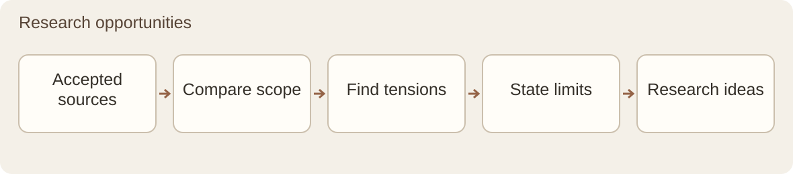

*Figure 15 · Research opportunities*

Research opportunities looks for two kinds of leads among admitted cards:

- **Tensions:** after comparing subjects, conditions, methods, metrics, statistics and time ranges, it finds places where conditions are comparable but conclusions differ.
- **Gaps:** it gathers the limitations, open questions and future work that authors state explicitly, keeps the original sentences and sources, and marks whether later papers have filled them.

Results fall into four groups: A, highly comparable tensions; B, differences in conditions or methods; C, differences in wording, metrics or claim type; D, items you chose to ignore. When coverage is insufficient, results are marked "not comparable" or "coverage limited". Analysis runs incrementally by topic, on a schedule, on demand or after related materials change; you decide what is comparable and what is worth pursuing.

### Literature discovery

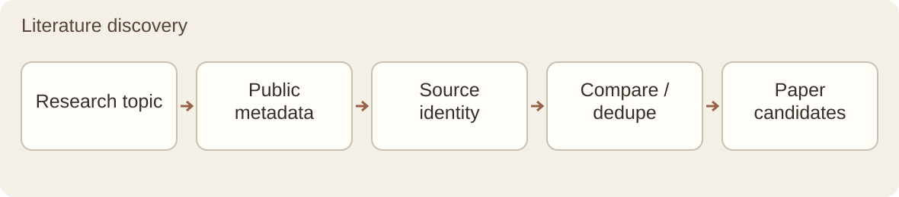

*Figure 16 · Literature discovery*

Literature discovery searches arXiv and Crossref by topic, keyword, author, journal or citation chain, and returns candidate papers with sources and reasons. Exact, conflict-free matches on DOI, arXiv ID or PMID are merged automatically; matches based only on title or author, or with conflicting identifiers, go to you for review. Preprints, conference versions, accepted manuscripts and published versions of the same work are kept as separate versions.

Each candidate's novelty is marked from four angles: publication date, when it was first seen, whether it is already in your library, and how it relates to your research direction. Anything that cannot be determined is marked unknown.

The home screen offers "Latest" and "Related" entries. Depending on your settings, records and links can be saved to the library automatically, and you add the full text. Candidates go through two confirmations: the first creates only pending candidate cards, and the second adds them to the library.

### Research recommendations

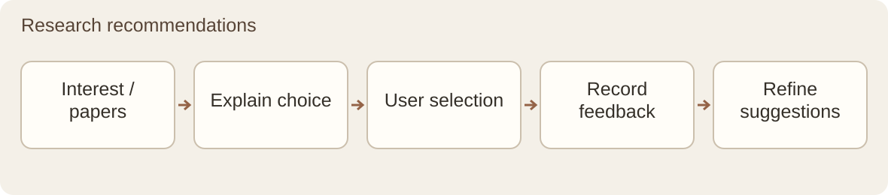

*Figure 17 · Research recommendations*

Building on literature discovery, research recommendations assembles a short list across five channels: core, adjacent, bridging, horizon and coverage repair. Each channel explains its own reasons, and channel scores are shown separately.

Recommendations you view or dismiss, and ones that reappear, are recorded. Dismissing affects only that paper and research direction; repeated signals only produce a strategy suggestion for you to confirm. Research recommendations finds and suggests; importing, raising weights and changing strategy are up to you.

## Model services and costs

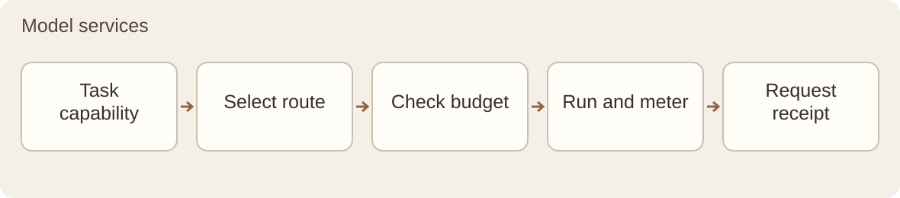

*Figure 18 · Model services*

### Roles and execution channels

Modules request models by role, such as embedding, card extraction, card review, analysis, analysis review, opportunity analysis, report writing, page OCR and reranking. At the start of each run, model services fixes the provider, model, prompt, parameters, execution location, permissions, budget and rollback target. Switching models is a configuration change; the business logic stays the same.

Execution runs as: role request → compile a work package → choose a channel → isolated task runner → API, command-line tool or local model → result plus a record of each call. The task runner manages processes, timeouts, heartbeats, cancellation and recovery. Seven command-line tools are supported out of the box, and you can define a custom command-line tool with its entry point, arguments and input/output rules.

### Configuration and failure handling

Each model configuration has two sets of states: runtime availability (unknown, available, degraded, missing) and enablement (candidate, approved, active, deprecated, quarantined, retired). Quality evaluation provides test results for each role, and you, or rules you have approved, decide which model to enable.

Each call records both the requested model and the model actually returned; during formal review, a mismatch stops the run, and models are never switched silently within a batch. Before a call, Memorive checks whether the network exit region meets the provider's regional policy, and the request is not sent if it does not or cannot be confirmed. Network glitches and rate limits are retried within budget. Problems with credentials, quota, a discontinued service or configuration pause only the affected steps, with the cause and how to fix it. A timeout never triggers an automatic switch to a paid service.

### Costs and usage

Each call records three things separately: how it was made (API, command line or local), where inference ran and how it is billed. An API request sent through a command-line tool is still billed as API usage, and a program running on your computer may still use cloud inference. The amount for a single call through a subscription CLI may be unavailable; it is then marked unknown and never counted as zero or free.

Costs are shown as actual, estimated, unknown or conflicting, by currency. They cover only the calls Memorive recorded; your provider's bill shows what you actually paid. Usage records cached and uncached input, total output, reasoning and visible output; reasoning tokens are part of the output and are not added twice.

### Input caching and session continuation

To give providers a chance to reuse input computation, stable rules and materials go first and the changing task goes last. Every task is still sent as its own request and fully checked, and review conclusions are worked out fresh each time. Cache support is identified per API, model and actual channel, and treated as unsupported when unknown.

With Codex, Memorive continues a session by its exact session ID, and starts a new session if the identity does not match, the session has expired or the previous attempt failed.

## Desktop app

### Technical structure

The Windows app is built with pywebview, PyInstaller and Edge WebView2. The interface calls the Python business layer through an application service: interface → IPC commands and events → application service → modules. Jobs, views and recovery state are stored locally, and the display is rebuilt after a disconnect or restart. The interface works on data only through the application service, and the library shows original sources, artifacts and version relationships.

### Main screens

| Screen | What it does |
| --- | --- |
| Settings | Interface language, model tiers, Thinking, credentials and capability status; changes are saved only after verification, and old values are restored on failure |
| Inbox and Current Tasks | Import, deduplicate, resolve conflicts and dispatch tasks; pause, cancel, resume, retry or switch configuration |
| Messages and Work Log | Separate "read" from "handled"; jump to the related task, step or artifact |
| Library and session library | View sources and generated content; collecting past sessions and adding them to the knowledge base are authorized separately |
| Model exams and costs | Show model qualification by role, test version and time; costs are shown by source type |
| Literature discovery and research reports | Recommendations need two confirmations before entering the library; reports describe changes |

The interface shows run status, paper results, review grounds, field confidence, coverage and version relationships separately. Results that "passed with omissions" list what is usable and why content was removed. Safe mode runs the core features read-only and loads no custom code.

### Processing steps

On the desktop, processing a paper takes nine steps:

| Step | What happens |
| --- | --- |
| 01 Document import | Convert, clean, chunk and record the source |
| 02 Source embedding | Fix the vector space for this run |
| 03 Card generation | Evidence extraction and local checks |
| 04 Card review | Run according to the review rules |
| 05 Card admission | Set admission status from the review grounds |
| 06 Analysis materials | Retrieve in the vector space from step 02 and pack within the budget from step 07 |
| 07 Analysis | Research analysis |
| 08 Analysis review | Independent review, or a recorded reason for skipping |
| 09 Human decision | Show evidence, objections and omissions for your decision |

Progress is calculated from actual step events and measurable work. Long tasks support resuming and heartbeats, with limits on cancellation, cost and retries. Reranking is currently off, and retrieval results are ordered by vector distance.

Analyses are reviewed and revised as follows: generate → independent sampled review → one targeted revision → independent review of the changes → pass, or remove content that is still disputed → your final review. Each aspect of the question keeps at least one supporting source, and the original, revisions, sources, objections and removal records are all kept.

### Session management and refinement

Session management lets you filter, search and page through conversations from Codex, Claude Code, local files and browser captures; each record keeps its source, sync time and first and last messages. The first full capture and later incremental captures each show their scope and completion status. Refinement results are saved as new artifacts, and the original conversation stays unchanged. [R3][R4]

For browser capture you choose Edge, Chrome or Brave. Memorive reads only through official exports, public APIs, content visible on pages you are signed in to, or a command-line tool's local session folder; cookies and browser storage are never read. After capture you can deduplicate and refine, producing 11 kinds of candidate content that you can place in 5 kinds of destination, and accept, edit, reject or defer each item. Conversations serve as research records; adding them to the knowledge base still requires the matching review.

### Model rankings

The rankings show models, providers, capability scores, input and output prices, currency, source dates and refresh status to help you choose a model. Sorting and filtering keep your current settings, and an unavailable source is shown as a failure. A public leaderboard reflects only the tasks and period it covers, so test a model on your own materials to see whether it suits your research. [R1][R2]

| Item | How it is shown |
| --- | --- |
| Capability | Benchmark, score and date; different benchmarks are shown separately |
| Price | Price per million input and output tokens, with currency, for reference |
| Status | Refresh time, source failures and missing items; unknown values stay unknown |

### Billing and usage panel

The "Billing and usage" panel at the bottom can be expanded and collapsed. The toolbar selects all records or the current task; the last 7 days, last 30 days or this month; and a specific model. The main area switches between cost (including estimates), request count and tokens, and the charts follow the filters. When the current task's costs cannot be fully attributed, the "current task" option is unavailable. Costs list actual and estimated amounts separately, request counts include failures and retries, and tokens are split into input and output. [R5]

## Privacy, storage and updates

### Data disposition

Data ownership and sensitivity are recorded separately. Cards currently distinguish own data (self) from entrusted data (entrusted). Own data is used according to your settings; entrusted data, data you may not dispose of, and data of unknown ownership are processed locally by default, and the related calls pause when no local capability is available.

Disposition rights are checked before any data goes to a model, including OCR, embedding, extraction, analysis, review and command-line tools, and context packs carry these limits as they are assembled and passed on. Collecting sessions, sending them to a model for refinement and adding them to the knowledge base are each authorized separately.

### Storage and credentials

The program folder holds the application; the data folder you choose holds materials, sessions, state and generated artifacts. Originals, text, cards, analyses and the version relationships between them are the assets to keep, and search indexes can be rebuilt from them. Back up content and version relationships together, and confirm a backup can be read before restoring from it.

Credentials are managed by your computer's credential store, and configuration keeps only references to them. Logs, documents and exports contain no keys, login tokens or browser cookies. Importing older settings keeps valid local references, and the credentials themselves stay where they are.

### Updates and uninstalling

Checking for updates, downloading and installing are three separate steps. Automatic checks fetch only official release information, and a failed check is reported as a failure. Downloads start after you confirm the version, notes and size. A delta package must match the installed version, and the assembled result must match the full package; if the versions do not match, you can switch to the full package after confirming. A failed signature or source check stops the update.

After the download is verified, choose "Update after exit": a separate update helper waits until Memorive finishes its tasks, saves and exits normally, then installs, without forcing the app to close. When the update is done, reopen Memorive and check the version, data locations and settings. The program, configuration and research data are handled separately, and recovery conditions are kept before switching; once the new version starts writing data, old backups are no longer used to overwrite new content. Existing review conclusions stay as they are after an update.

Installation, update and uninstall screens are available in Chinese, English and Japanese. Uninstalling keeps your data by default.

## Reference projects

| Mark | Project | What was referenced |
| --- | --- | --- |
| R1 | [LiveBench/LiveBench](https://github.com/LiveBench/LiveBench) | Public benchmarks and results used as a source for the rankings |
| R2 | [LiveBench/new-livebench](https://github.com/LiveBench/new-livebench) | Presentation by release date, task breakdown and cost comparison |
| R3 | [farion1231/cc-switch](https://github.com/farion1231/cc-switch) | Information architecture for cross-tool session management |
| R4 | [CC Switch Session Manager](https://github.com/farion1231/cc-switch/blob/main/session-manager.md) | Design of the session entry, list and detail views |
| R5 | [CC Switch Usage Statistics](https://github.com/farion1231/cc-switch/blob/main/docs/user-manual/en/4-proxy/4.4-usage.md) | Presentation of usage fields, caching and cost estimates |

The rankings' per-dimension comparison, version dates and source labels follow LiveBench, and prices come from each provider's public catalog. Session management follows CC Switch's Session Manager, and Memorive adds a link into the research workflow, refinement and human review. The billing panel's layout follows CC Switch's Usage Statistics. These references concern information architecture and presentation; Memorive's code was written independently.
