# Memorive 設計概要

*利用者と開発協力者のための設計解説 · v1.03 · 2026 年 10 月*

Memorive は、資料の処理、研究 Q&A、引用の確認、知識の再利用を一つの流れにまとめます。この文書では、データの流れ、各モジュールの役割、エラー時の扱いを説明し、Memorive が原文までたどれる研究記録をどう作るかを紹介します。フィールド定義、プロンプト、しきい値、テスト記録は各モジュールの契約と実行記録で管理しており、ここでは設計の考え方を扱います。

## 設計の原則

**最終判断は研究者が行う。** AI は理解、整理、分析、推薦、注意喚起を担います。取り込み、知識登録、知識への反映、公開は研究者が確認し、元のデータの扱いも研究者が決めます。自動で動くタスクは、許可された範囲の中だけで実行されます。

**資料はツールより長く残る。** 原本、Markdown、文献カード、ノート、判断記録は長く保存し、モデルやソフトウェアはいつでも入れ替えられます。検索インデックスや画面表示はこれらの資料から作られ、いつでも作り直せます。

**品質は根拠で判断する。** 形式の正しさ、内容の信頼性、抽出の完全さ、出典の追跡可能性は、それぞれ別に確認します。重要な数値、因果関係、論文に使う予定の内容を優先して確認します。個別に扱える通常の不足は残したうえで明示し、中心となる根拠が崩れた場合や、出力を続けると誤解を招く場合にだけ処理を止めます。

**原文とすべての版を残す。** 資料は元の言語のまま保存し、翻訳は表示の段階だけで行います。変更すると新しい版ができ、以前の内容、レビュー記録、失敗の記録も残ります。

**必要に応じて段階的に作る。** まず最小限の研究の流れを完成させ、そのあと品質管理、版の管理、研究運営を加えます。新しい機能には、それぞれ明確な役割と依存関係があります。

## 全体の構成

Memorive には四つの主な流れがあります。

- **資料処理**：取り込み → 資料処理 → 証拠抽出で文献カードを作成 → 証拠レビュー → 知識登録 → 通常の検索へ。
- **研究 Q&A**：質問 → 証拠検索でコンテキストパックを作成 → 研究分析で回答を作成 → 必要に応じて独立レビュー → 利用者が判断。
- **知識の再利用**：登録済みの資料から研究機会を見つけます。選んだ結論は知識への反映で候補になり、確認すると知識に加わります。
- **外部の文献探索**：文献探索が設定した研究方向の書誌情報を集め、研究資料の推薦が候補をまとめます。書誌情報とリンクは自動でライブラリに保存でき、本文は利用者が追加して、通常の処理と登録の流れに進みます。

原本や処理途中の結果はいつでも保存できます。通常の検索と分析に使う資料は、先に登録を済ませる必要があります。研究レポート、データ・論理チェック、アプリ更新・保守は、これらの流れを支える補助モジュールです。

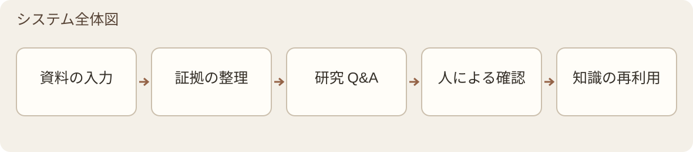

*図 1 · システム全体図*

### モジュールの分担

| 分類 | モジュール | 役割 |
| --- | --- | --- |
| 処理と分析 | 資料処理、証拠抽出、証拠検索、研究分析 | 元の資料から引用できる根拠と分析の回答を作る |
| 共通サービス | 証拠レビュー、検索の重み付け、知識登録、モデルサービス | 内容のレビュー、検索の並び順、登録状態、モデルの呼び出し |
| チェック | データ・論理チェック、品質評価 | 数値と論理を確認し、全体の品質を継続的に評価する |
| 記録と再利用 | 知識への反映、実行記録、判断記録、バージョンと来歴 | 反映候補を管理し、実行の経過、判断の理由、版の関係を記録する |
| 研究運営 | 研究機会、研究レポート、文献探索、研究資料の推薦 | 食い違いと空白を見つけ、変化を報告し、新しい文献を探して推薦する |
| デスクトップアプリ | アプリケーション層、タスク実行、アプリ更新・保守 | 画面と各モジュールをつなぎ、タスクを実行し、インストールと更新を管理する |

各モジュールは自分の役割だけを担います。資料処理は変換と OCR の品質、証拠抽出は抽出と構造のチェックを担当します。研究分析は引用が今回の資料から来ているかを確かめ、証拠レビューは根拠が主張を支えているかを判断します。知識登録は、依頼と根拠に基づいて状態を変えるだけです。技術的な再試行はモデルサービスとタスク実行が、内容の修正は証拠抽出と証拠レビューが担当し、実行記録は記録だけを行います。

## データの保存

### 二つの層

**ソース層**には、原本とたどれるテキストを保存します。PDF などの元のファイル、変換した RawMD、整形した CleanMD、分割したチャンクです。原本が最終的な根拠となり、変換結果には元の位置と変換の記録が残ります。

**カード層**には文献カード（Card）を保存します。各カードは一つの論文を忠実に要約したもので、検索、比較、確認に使います。個人のメモ、複数文献のまとめ、分析レポート、反映された内容は別の派生物として、カードとは分けて保存します。

ベクトルインデックス、フィールドベクトル、デスクトップのライブラリは**アクセス層**です。特定のソースと版を指しており、いつでも作り直せます。

### 識別子、出典、言語

各論文には変わらない paper_id があります。保存される成果物はすべて、ID、内容のハッシュ、スキーマの版、出典の範囲、親の版、実行回、実行設定を記録します。複数の論文にまたがるコンテキストパックや分析は、複数の親を持てます。

カードの重要な内容は、要約と一緒に出典アンカー（チャンク ID と原文の引用）を保存します。引用は対応するチャンクの中に見つかる必要があり、要約の内容が正確かどうかはそのあとレビューで判断します。古いデータに欠けている識別情報や出典情報は「不明」とし、ファイル名や似た文章から推測することはありません。

原文、テキスト、カードは元の言語のままです。画面、システムメッセージ、新しく作る回答、提案、レポートは、選んだ内容言語で出力されます。原文、引用、書誌情報、過去の版はそのまま残ります。言語はタスクの開始時に決まり、キャッシュも言語ごとに分けています。

### 比較のための項目

複数の文献を比べるとき、Memorive は共通の項目で各結論の条件を表します。

| 項目 | 意味 |
| --- | --- |
| Research Object | 研究対象、材料、標本、テキスト、システム |
| Intervention / Factor | 調べた要因や介入 |
| Comparator | 対照や比較の基準 |
| Method | 方法、研究デザイン、分析の枠組み |
| Metric | 評価指標とその意味 |
| Boundary Condition | 結論が成り立つ条件と範囲 |
| Scale / Context | 規模、場面、応用の背景 |
| Claim Type | 結論の種類：因果、相関、メカニズム、性能、手法の検証など |

分野ごとに変えるのは項目の別名だけです。証拠抽出がこれらの項目を埋め、研究機会はそれを使って二つの結論が比較できるかを判断します。

## 資料の処理

### 資料処理

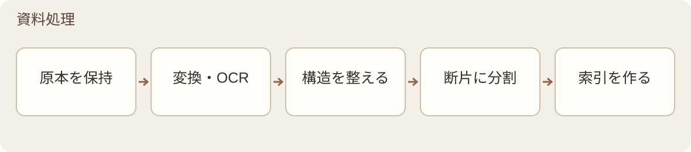

*図 2 · 資料処理*

資料処理は、元の文書、画像、ノートから、原本の保存、RawMD、CleanMD、チャンク、ベクトルインデックスを作り、各ステップの変換結果を記録します。

| ステップ | 内容 |
| --- | --- |
| 取り込み | 原本と出典、識別情報、日時、データの取り扱い権限のラベルを保存する |
| 変換 | PDF などを RawMD に変換し、問題のあるページは必要に応じて OCR を行い、変換レポートを作る |
| 整形 | ヘッダー、フッター、余計な改行、段組みの混在などのレイアウトの乱れをローカルのルールで取り除く |
| 分割 | 章、段落、表、図の説明ごとに分け、変わらないチャンク ID を付ける |
| ベクトル化 | 選んだモデルでベクトルを作り、モデルと日時を記録する |

解析結果には、段落、表、上付き・下付き文字、ページと行のアンカーが残ります。ローカルの Marker 解析も選べます。

**ページ単位の OCR。** 通常のデジタル PDF はローカルで解析します。OCR を行うのは、スキャンしたページ、文字がほとんどないページ、文字化けしたページ、構造が壊れたページだけです。まずローカルで診断し、データの取り扱い権限を確認してから、選んだ OCR モデルに送り、元の解析結果と並べて確認したうえで統合します。一部のページが失敗しても、ほかのページはそのまま残り、欠けたページは明示されます。

**ノートの確認。** ノートは変換後に既定で一時停止し、書き起こしと書式を確認してから処理を続けます。

**ベクトルの作り直し。** 名前が同じモデルでもベクトル空間が異なることがあるため、古いインデックスを使い回す前に次元、正規化の方法、距離の尺度を確認します。ベクトルを作り直すときは、新しいテキストを作れることを確かめてから古いベクトルのスナップショットを保存し、消去して作り直します。途中で止まった場合はスナップショットから戻します。

現在対応しているファイル形式は 14 種類です。JPEG、PNG、TIFF はこのステップでは画像そのものを確認するだけで、画像内の文字は読み取りません。旧形式の Office ファイルは、お使いの PC の Office で変換し、変換中はマクロとリンクの更新を無効にします。

### 証拠抽出と文献カード

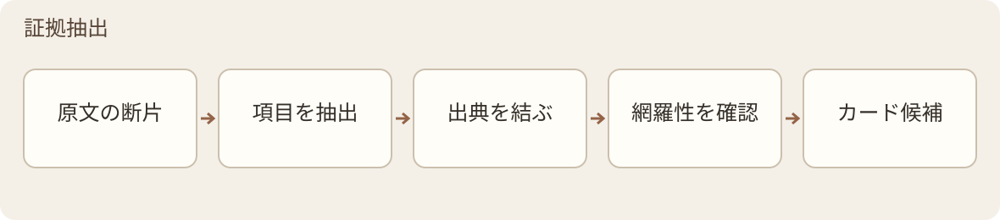

*図 3 · 証拠抽出*

証拠抽出は、一つの論文の CleanMD とチャンクを読み、文献カード、補助的な抽出結果、網羅状況の記録を作ります。カードはまずローカルのチェックを通り、そのあと証拠レビューと知識登録に進みます。

カードの中心となる項目は、研究課題、対象、方法、主な結果、著者の結論、適用条件、出典アンカーです。補助的な抽出には、主要なデータ、比較のための項目、著者が述べた限界と今後の課題、必要に応じて用語と引用関係が含まれます。研究そのものの限界と、結論が成り立つ範囲は分けて記録します。個人の考え、批評、仮説、複数文献のまとめはカードの外で扱います。

| ルール | 抽出の要件 |
| --- | --- |
| R1–R2 | 著者の主張の強さを保ち、複数段階の手順や複数群の比較は省かずに残す |
| R3–R4 | 数値は統計の種類、段階、標本、範囲とともに抽出し、指標は対象範囲、分母、対照を明記する |
| R5–R6 | 結論には実際の適用条件を添え、研究対象と、評価や試験に使った試料を区別する |
| R7–R8 | 用語は著者の定義に従い、出典アンカーは実際に内容を取った箇所を示す |
| R9 | 論文にある情報はすべて抽出し、本当にない情報はないと明記する。明らかな誤記を文脈から解釈した場合は、元の値、根拠、修正の跡を残す |

**網羅状況。** 必須項目ごとに、原文にある、原文にない、該当しない、抽出漏れ、未評価のいずれかを記録します。「見つからない」と「原文にない」は分けて記録します。

**作成と修正。** カードを書き出す前に、スキーマ、型、出典 ID、アンカー、項目間の制約を確認し、重要な引用は原文と一字ずつ照合します。レビューで修正できる問題が見つかったら、カードごとに一度まとめて修正し、問題のある項目だけを変えます。全体的な失敗の場合は新しいカードと実行回を作り、前回の失敗結果は残します。

**長い論文。** とても長い論文は分割して抽出し、段階的に統合します。結果は全体がそろってから表示されます。

## 検索と Q&A

### 証拠検索

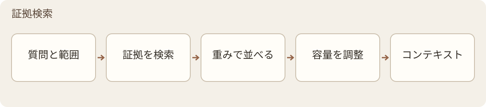

*図 4 · 証拠検索*

証拠検索は、質問、使える資料、重み付けの設定をもとに、出典付きで長さに上限のあるコンテキストパックを作ります。手順は三つで、質問の理解、候補の取り出し、コンテキストのまとめです。まずカードと項目の手がかりで探し、必要なら原文まで掘り下げます。カードのアンカーは手がかりにすぎず、モデルに渡す根拠のテキストは原文のチャンクから取ります。

まとめるときは、トークンの上限、出典の多様さ、質問のさまざまな側面、役に立つ反例のバランスを取ります。同じ章の表とその見出しや脚注、すぐ隣り合う段落は、まとめて渡せます。コンテキストパックは、質問のどの側面を扱えたか、扱えなかったかを記録し、各資料のデータの取り扱い制限を分析とレビューまで引き継ぎます。

### 検索の重み付け

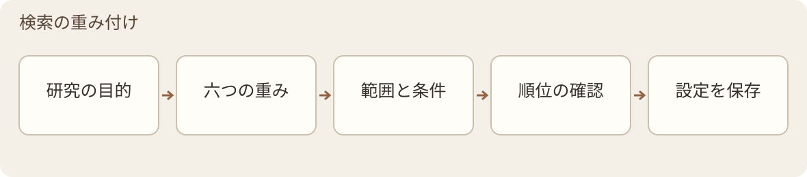

*図 5 · 検索の重み付け*

| 分類 | 重み | 意味 |
| --- | --- | --- |
| 関連性 | SimilarityWeight | 現在の質問とのベクトル類似度 |
| 関連性 | SemanticWeight | 質問の各側面について計算した項目の関連性 |
| 権威と個人的な価値 | ManualWeight | 理由を書いたうえで利用者が設定する重要度 |
| 権威と個人的な価値 | RuleWeight | 発表年、掲載誌、被引用数、文献の種類などの手がかり |
| 権威と個人的な価値 | NoteWeight | ノートや注釈などの研究の痕跡 |
| 権威と個人的な価値 | CitationWeight | 自分の研究でその資料を引用した回数と用途 |

最終スコア = 関連性の加重和 + 派生係数 × 権威の加重和。各係数は研究の目的に合わせて調整できます。

**派生した内容の重みを下げる。** 複数文献のまとめ、概念の関係、個人のメモなどの派生した内容は、権威のスコアだけを下げ、関連性は通常どおり計算します。複数文献のまとめが最も大きく下がり、個人のメモが最も小さく下がります。こうすることで、二次的なまとめが元の論文を押しのけないようにしています。フィールドベクトルは登録済みのカードだけに作り、原文のベクトルとは分けて保存します。

### 研究分析

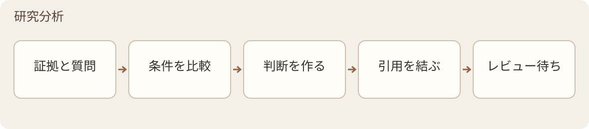

*図 6 · 研究分析*

研究分析は、質問とコンテキストパックから回答を作ります。回答は四つの部分に分かれます。文献に裏付けられた内容と引用、ライブラリの文献以外からの AI による補足、リスクと不確かさ、確認したほうがよい原文の箇所です。資料が質問を十分に扱えていないときは AI の補足を控え、研究そのものの限界、出典どうしの食い違い、検索の漏れを分けて説明します。

研究分析は、各引用が今回のコンテキストパックから来ているかを確認します。条件を満たさない引用は理由を添えて文献の裏付け部分から外し、残りの内容は保持します。根拠が十分か、主張が言い過ぎていないかは、証拠レビューが独立して判断します。回答は観点、根拠、分析の構成を示すもので、最終的な結論は利用者がまとめます。

**回答の版。** 各回答には、使った出典、条件、スタイルの設定が記録されます。作り直すと新しい回答の分岐ができ、前の分岐は残りますが新しいコンテキストには含まれません。コピー、版の切り替え、下書きの復元ではモデルを呼び出しません。30 日間開いていない会話や、メッセージが 100 件を超えた会話は自動でアーカイブされます。ピン留めした会話と使用中の会話は対象外です。

### 研究 Skill

memo-research Skill を使うと、Codex や Claude Code などのエージェントに文献を読ませ、引用を確認させることができます。研究 Q&A で「エージェントへ引き継ぐ」を押してデスクトップアプリを選ぶと、Memorive は引き継ぎフォルダーを用意します。中には会話、資料の原本、抽出した本文、Memorive に付属する Skill が入っています。エージェントのアプリを開き、コピーされたプロンプトを貼り付けてください。エージェントは Skill に従って関連する箇所を探し、原文を引用した回答を書き、確認してから同じ会話に戻します。戻すときに Memorive のローカルコマンドを実行するので、エージェントが許可を求めたら許可してください。戻せなかった場合、回答は引き継ぎフォルダーに保存され、会話の添付から戻せます。戻ってきた回答が自動で知識に加わることはありません。

Memorive を使わずに単体で使う場合、Skill は論文ごとに原本、RawMD、source.json を残します。研究 Q&A の添付から source.json を選ぶと、Memorive は確認したうえでそのまま再利用し、変換をやり直しません。

## レビューとチェック

### 証拠レビュー

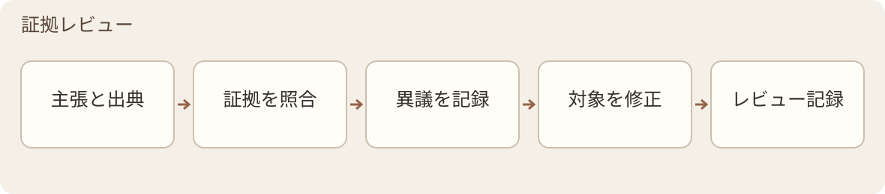

*図 7 · 証拠レビュー*

証拠レビューは、カードや分析の各主張が根拠に支えられているかを確認します。カードと分析にはそれぞれ専用のレビューモデルを使い、レビューモデルは内容を作ったモデルとは別のモデルファミリーから選びます。

**カードのレビュー。** まず全体を一度レビューし、問題がなければ完了です。修正できる問題が見つかった場合は一度まとめて修正し、変更した部分だけを再レビューしてから、最後に全体を確認します。内容を削除するのは、誤りが明確で、一つに特定でき、切り離せる場合だけで、削除した内容は記録に残します。判断が分かれる場合は利用者に回します。すべて解決したカードは「完了」、一部を省いても使えるカードは「省略ありで合格」となり、中心的な問題が残るカードは失敗のまま、または利用者の判断待ちになります。

**分析のレビュー。** リスクに応じて、レビューするかどうかと範囲を決め、省略するときは理由を記録します。レビューモデルが見るのは主張と引用された根拠だけで、回答を作ったときの推論は見ません。

### データ・論理チェック

データ・論理チェックは、文献の本文と表にある数値の関係と内部の論理を調べます。レポートには、原文の位置、根拠、適用条件、確認できた範囲が示されます。

ルールによるチェックでは、まずパーセント、比率、単位、統計値の意味を確かめ、そのうえで明示された等式、範囲、数値の関係を確認します。条件が足りない場合や比べられない場合は「要確認」または「確認範囲が限定的」とし、分母やグループを推測することはありません。モデルによる論理チェックは、原文に根拠のある疑問点を挙げます。ルールの結果、モデルの疑問点、利用者の意見は分けて保存し、モデルの疑問は利用者が確認するまで疑問点のままです。

このチェックはレポートを作るだけで、原文はそのまま残り、著者の意図も推測しません。証拠レビューとは役割が異なり、こちらはデータと論理そのものを、証拠レビューは根拠が抽出した主張を支えているかを見ます。二つの結果は分けて保存します。

### 品質評価

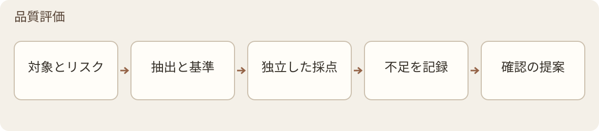

*図 8 · 品質評価*

品質評価は、ランダムな抜き取り、リスクに基づく抜き取り、固定のベンチマークテストで品質を継続的に確認します。重みが高い内容、よく引用される内容、論文に使う予定の内容、レビューで意見が分かれた内容を優先して抜き取ります。モデル、プロンプト、ルールを変えたあとは、対応するテストパックでもう一度確認します。

| 品質の観点 | 確認すること |
| --- | --- |
| 文字の忠実さ | 文字、数値、単位、引用が出典どおりか |
| 根拠の網羅 | 根拠が主張の条件、範囲、比較対象を押さえているか |
| 成果物間の一貫性 | カード、コンテキストパック、分析、レビュー、公開物のあいだで矛盾がないか |
| 科学的な妥当性 | 統計の取り方、単位、標本、時期、桁が妥当か |
| 版の新しさ | 元にした上流の版が互換で、古くなっていないか |

五つの観点は別々に記録し、未評価の観点はそのことがわかるように表示します。数値を比べる前に、指標、単位、条件、統計の種類、時期、標本、対照をそろえ、そろえられないものは「直接比較できない」とします。OCR の結果では本文と表紙、目次、ヘッダー・フッター、参考文献を区別し、本文以外の数値を研究結果と取り違えないようにします。

ベンチマークはタスクの役割ごとに管理します。各版で問題、模範解答、採点プログラム、一覧を固定し、モデルが変わっても同じものを使います。模範解答はローカルでの採点だけに使い、テスト対象のモデルには渡しません。

## 知識と記録

### 知識登録

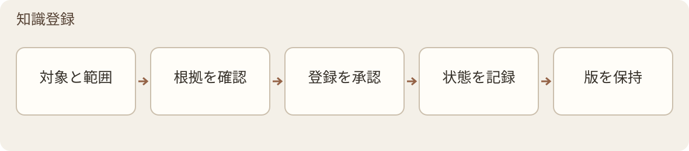

*図 9 · 知識登録*

カードには三つの登録状態があります。保留（pending）、登録済み（active）、隔離（quarantined）です。保留中のカードは閲覧とレビューができ、通常の検索、研究機会の分析、自動的な反映に使われるのは登録済みのカードだけです。

知識登録は、明確な依頼と根拠がある場合にだけ状態を変えます。変更のたびに書き換えられないイベントが作られ、実行記録に保存され、バージョンと来歴に関連付けられます。品質の判断、再試行、修正はほかのモジュールが担当します。

### 知識への反映

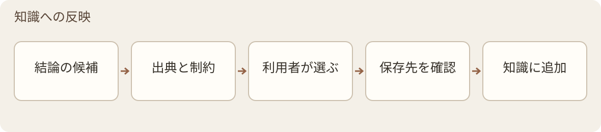

*図 10 · 知識への反映*

注釈、判断、仮説、安定した概念の関係、複数文献のまとめを、知識に反映できます。自分のメモは自動で保存したり、候補として自動で整理したりできますが、知識に加えるには利用者の確認が必要です。

流れは次のとおりです。内容を選ぶ → 出典と理由付きの候補を作る → 置き場所と変更内容を確認する → 採用、修正、却下、保留のいずれかを選ぶ → 必要なレビューと登録 → 版を保存する。確認済みのまとめも二次的な内容であることに変わりはなく、派生した内容として重みが下がり、元の論文ほどの権威は持ちません。

### バージョンと来歴

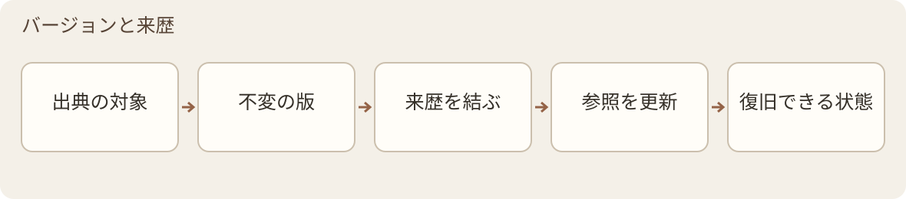

*図 11 · バージョンと来歴*

すべての成果物に、変わらない ID、内容のハッシュ、種類、実行回、出典の範囲、作成日時、一つ以上の親の成果物があります。原本、テキスト、カード、反映内容、判断を変更すると新しい版ができ、前の版は残ります。

| ライフサイクル | 意味 |
| --- | --- |
| 利用頻度：アクティブ / コールド / アーカイブ | 検索の優先度に影響し、削除とは別 |
| 版：最新 / 置き換え済み / 履歴 | 版の置き換えと履歴を記録する |
| 派生物：下書き / 最新 / 置き換え済み / 履歴 | メモやまとめなど派生した内容の版の状態 |

Memorive は、正確な親の版、スキーマ、出典の範囲から、成果物がまだ互換かどうかを判断します。親の版が欠けている場合は「来歴不明」とします。カードを更新すると、古いカードをもとにした分析には、古くなっている可能性が表示されます。

### 実行記録と判断記録

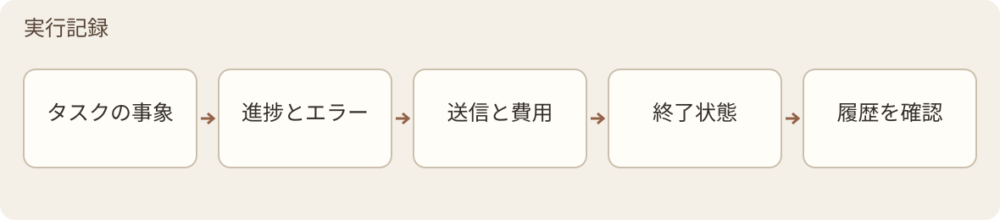

*図 12 · 実行記録*

実行記録は、各モジュールとタスクのイベントを保存します。利用者向けには進捗とエラーを、原因調査向けにはモジュール、対象、段階、原因、根拠の場所を残します。実行記録は記録に専念し、判断や修正はほかのモジュールが行います。

| 記録 | 内容 |
| --- | --- |
| 試行の記録 | 実際の呼び出しごとの結果、経路、根拠 |
| 文献ごとの結果 | 各論文の実行回ごとの最終結果。やり直すときは新しい実行回になる |
| 公開の記録 | 公開の依頼、選んだ内容、結果、受領記録 |

あとで成功した場合は新しい記録が追加され、前の失敗の記録も残ります。外部への呼び出しは、送信前に依頼の識別情報、経路、権限、予算を記録し、返ってきたあとで実際に応答したモデル、使用量、費用、遅延を補います。古いデータに欠けている項目は「不明」とします。

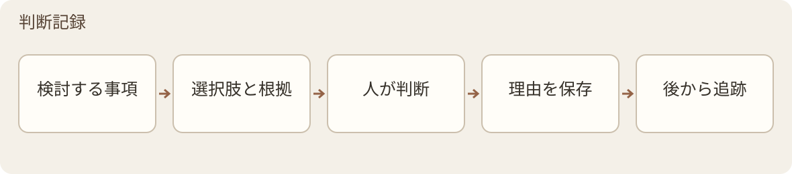

*図 13 · 判断記録*

判断記録は、モデルの採用、ロールバック、ベクトルの作り直し、公開、取り下げなどの重要な選択について、背景、選択肢、最終的な選択、採らなかった理由、影響の範囲、見直しの日付を保存します。実行記録は何が起きたかを、判断記録はなぜそう決めたかを示します。判断が変わったときは新しい記録を作り、元の判断と理由は残します。

### 研究レポート

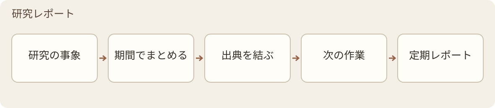

*図 14 · 研究レポート*

研究レポートは、実行記録、登録、版の変化から研究のイベントを整理し、日報、週報、月報を作ります。日報は追加、変更、レビュー待ち、失敗を、週報は主な進展、新しい文献、未完了のレビュー、食い違いの可能性を、月報は構造の変化と長期的な課題を扱います。レポートは変化、リスク、やるべきことを伝えるもので、登録状態はそのまま残ります。ホーム画面の AI近況は研究レポートとは別の機能で、使う資料の範囲も異なります。

## 研究機会と文献探索

### 研究機会

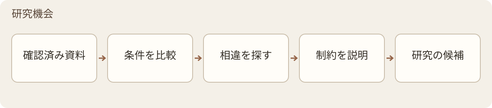

*図 15 · 研究機会*

研究機会は、登録済みの論文カードを比べて三種類の手がかりを探します。

- **相違**：2 本以上の論文が、比較できる対象と指標について、方向や大きさの異なる結果を示しているもの。
- **条件の違い**：結果が異なり、対象、方法、標本、指標、場面のいずれかも異なるもの。結果の違いは、これらの条件の違いから来ている可能性があります。
- **空白**：どの論文も答えていない問い、1 本の論文しか扱っていない問い、著者が未解決と明記している問い。

研究機会は研究 Q&A のページ（サイドバーの「研究チャット」）のもう一つのモードです。ページのタイトル、またはタイトルの横にある「研究の機会に切り替え」を押すと切り替わり、もう一度押すと研究 Q&A に戻ります。論文カードがあると、ホーム画面に「論文の間に掘り下げたい点はありますか？」と表示されることがあり、そこにある「研究の機会を見る」または「探してみる」からもこのページが開きます。既定では「ライブラリ全体」を比較し、「比較範囲」で比較グループに切り替えられます。「注目するキーワード」に語句を入力して Enter で追加すると（最大 5 個）、モデルはそれに関係する機会を優先して探します。「研究の機会を探す」を押すと、研究 Q&A で選んだモデルで探し始めます。研究 Q&A の設定でモデルを選んでいないとき、または処理済みの論文がないときは押せません。同時に実行できる研究タスクは一つです。探している間は「キャンセル」を押せます。モデルにすでに送った依頼がある場合は、その応答が返ってから止まります。「タスクを見る」を押すと、この検索の実行記録が開きます。

Memorive は各論文カードの研究課題、研究対象、方法、比較条件、主要データ、主な結果、著者の結論、境界条件、著者が述べた限界と展望を事実の一覧にまとめます。原文の位置が分かる事実には、ページと章を記録します。カードに原文が保存されている場合は、原文の引用も添えます。論文は研究課題、研究対象、方法、主要データに共通する語で論文グループに分け（1 つにつき最大 12 本）、論文グループごとにモデルを一回呼び出します。モデルが挙げる機会はすべてこれらの事実を引用し、Memorive が一件ずつ確認します。確認するのは、引用した事実が実在すること、相違と条件の違いが 2 本以上の論文にまたがること、タイトル、問い、判断の理由、項目ごとの比較に書かれた数値が引用した論文の事実に出てくることの三点です。% の付かない 10 以下の整数と、解決の手がかりと限界に書かれた数値は確認しません。確認を通らない機会は表示されません。ある論文グループの呼び出しが失敗しても、ほかの論文グループの結果はそのまま残り、今回の結果は「一部完了」と表示されます。

見つかった機会は、新しいもの、スター付き、質問済みの順に並びます。各機会のカードには、種類、タイトル、掘り下げる問いが書かれています。「詳細」を開くと、判断の理由（「根拠」）、項目ごとの比較、解決の手がかり、限界、根拠となる記述（「根拠 · N」。論文、カードの項目、ページ、章、原文の引用）を確認できます。「項目ごとの比較」には、比べた項目（対象、方法、標本、指標、条件、結果）ごとに「同じ」「異なる」「不明」と説明が表示され、比べた項目がない機会では表示されません。追いかけたい機会には「スター」を付けます。「無視」を押すと一覧の下にある「無視」の欄に移り、必要になったら「復元」で戻せます。「研究 Q&A で質問する」を押すと、Memorive は研究 Q&A で今開いているプロジェクトに新しい会話を作り、関係する論文を添付し、問いを入力欄に入れて送信を待ちます。回答はほかの研究 Q&A の回答と同じく原文を引用します。残したい結論は、知識への反映で候補になり、確認すると知識に加わります。

**比較グループ。** 一部の論文だけを比べたいときは、検索欄の左下にある「＋」（「論文を追加」）か、ウィンドウの「サイドパネルを表示または非表示」ボタン（Ctrl+Alt+B）を押します。右側に論文を選ぶパネルが開きます。パネルには過去 30 日に処理した論文が表示され、名前で検索するとすべての論文から探せます。選べるのはカードが登録済みの論文だけで、それ以外の論文には「カード確認待ち」などの理由が表示されます。「確認」を押すとパネルが閉じます。比較範囲が「ライブラリ全体」のときは、選んだ論文が新しい比較グループとして保存され、「比較グループ N」と自動で名前が付き、そのまま比較範囲に選ばれます。比較グループを選んでいるときは、そのグループの論文が更新されます。「確認」を押さずにサイドパネルのボタンで閉じたり研究 Q&A に戻ったりすると、選択の変更は保存されません。グループの論文はキーワードの上に表示され、× を押すと外せます。名前は「比較グループの名前を変更」で変えられます。「比較グループを削除」を 5 秒以内に 2 回押すと、グループが削除されます。削除しても論文はライブラリに残り、比較範囲は「ライブラリ全体」に戻ります。比較グループで探すには、カードが登録済みの論文がグループに 2 本以上必要です。あとでカードが登録済みでなくなった論文はグループに残ったまま状態が表示され、探すときには使われません。

パネルからはディスク上のファイルも追加できます。「エクスプローラーを開く」では、PDF、MD、TXT、DOCX のファイルを一度に 32 個まで（1 ファイル 64 MB まで）選べます。ファイルの種類は最初 PDF になっているので、ほかの形式は種類を切り替えて選びます。33 個以上を選ぶと、まとめて追加できません。ファイルは受信箱にコピーされて処理が始まり、グループには「待機中」「処理中」「カード確認待ち」などの状態が表示されます。処理が終わってカードが登録されると、自動でグループに加わります。「処理未完了」「カードが作成されませんでした」「カード停止中」「受信箱から削除済み」と表示されたファイルはグループに加わらないので、× で外してください。以前に処理し、カードが登録済みのファイルはすぐに加わります。比較グループを選んでいないときは、先に新しいグループが作られます。「外部ライブラリを開く」では、接続したライブラリのフォルダーからファイルを選びます。使うライブラリは「設定 › 研究チャットと接続 › エージェントと接続」の「研究の機会に使う外部ライブラリ」で選び、設定画面の保存で確定します。選べるのは、研究 Q&A で有効にした Obsidian、Zotero、フォルダーなどの接続です。

研究機会は自動では実行されません。前回ライブラリ全体で探したあとに処理された論文の数は「前回の検索以降に追加された論文 · N」と表示されます。いつ探し直すかは利用者が決めます。同じ機会がもう一度見つかったときは、付けた印がそのまま残ります。根拠となった論文カードが変更または削除されると、その機会に「根拠の論文カードが変更されました。探し直すことをおすすめします」と表示されます。検索が「完了」または「一部完了」で終わると、結果は「研究の機会 · 日付」という題でライブラリに保存され、メッセージで通知されます。保存される結果には、今回新しく見つかった機会だけが載ります。無視していない相違と条件の違いは、週報の「出典の明確な潜在的矛盾」に載ります。研究機会は掘り下げる価値のある問いを示します。どの論文が正しいかは利用者が判断します。

### 文献探索

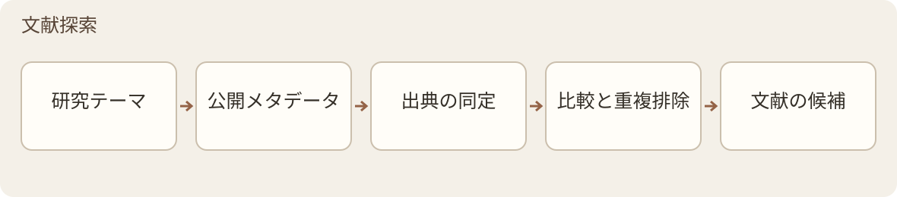

*図 16 · 文献探索*

文献探索は、テーマ、キーワード、著者、掲載誌、引用のつながりをもとに、arXiv と Crossref から出典と推薦理由付きの候補文献を集めます。DOI、arXiv ID、PMID が完全に一致し矛盾がない場合は自動で重複をまとめます。タイトルや著者だけで一致した場合や、識別子が矛盾する場合は利用者の確認に回します。同じ研究のプレプリント、会議版、採択稿、出版版は、別々の版として残します。

各候補の新しさは、発表日、最初に見つけた日、すでにライブラリにあるか、研究方向との関係の四つの観点で示し、判断できないものは「不明」とします。

ホーム画面には「最新」と「関連」の二つの入口があります。受信設定に応じて、書誌情報とリンクは自動でライブラリに保存でき、本文は利用者が追加します。候補は二回の確認を経ます。一回目は保留中の候補カードを作るだけで、二回目で正式にライブラリに加わります。

### 研究資料の推薦

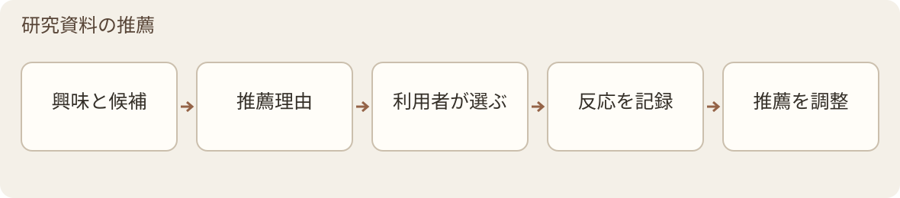

*図 17 · 研究資料の推薦*

研究資料の推薦は、文献探索の結果をもとに、コア、隣接、橋渡し、展望、網羅の補完という五つのチャネルで、数を絞った推薦をまとめます。チャネルごとに推薦理由を示し、スコアもチャネルごとに分けて表示します。

推薦を見たか、無視したか、再び現れたかは記録されます。無視は対象の文献と研究方向にだけ適用され、繰り返し現れるシグナルは、利用者の確認を待つ方針の提案になるだけです。推薦は候補を探して示す役割で、取り込み、重みの引き上げ、方針の変更は利用者が決めます。

## モデルサービスと費用

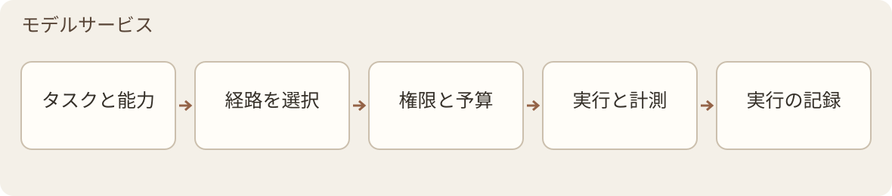

*図 18 · モデルサービス*

### 役割と実行経路

各モジュールは役割を指定してモデルを呼び出します。ベクトル化、カードの抽出、カードのレビュー、分析、分析のレビュー、研究機会の分析、レポートの作成、ページ OCR、再ランキングなどです。実行回の開始時に、モデルサービスは提供元、モデル、プロンプト、パラメーター、実行場所、権限、予算、ロールバック先を固定します。モデルを替えるときは設定を変えるだけで、処理の内容は変わりません。

実行の流れは、役割の依頼 → 作業パッケージの作成 → 経路の選択 → 独立したタスク実行 → API、コマンドラインツール、ローカルモデル → 結果と呼び出しごとの記録、です。タスク実行は、プロセス、タイムアウト、ハートビート、キャンセル、復旧を管理します。現在は七種類のコマンドラインツールに対応しており、入口、引数、入出力のルールを指定して独自のコマンドラインツールも追加できます。

### 設定と障害時の扱い

モデルの設定には二種類の状態があります。実行時の利用可否（不明、利用可能、性能低下、なし）と、採用の状態（候補、承認済み、使用中、非推奨、隔離、廃止）です。品質評価が役割ごとのテスト結果を出し、どのモデルを使うかは利用者、または利用者が承認したルールが決めます。

呼び出しのたびに、依頼したモデルと実際に応答したモデルを記録します。正式なレビューで両者が一致しない場合は処理を止め、同じバッチの途中でモデルが黙って替わることもありません。呼び出しの前には、ネットワークの出口の地域が提供元の地域ポリシーに合っているかを確認し、合わない場合や確認できない場合は送信しません。ネットワークの一時的な不調やレート制限は予算の範囲内で自動的に再試行します。認証情報、利用枠、サービスの終了、設定に問題がある場合は、影響を受ける処理だけを止め、原因と対処方法を示します。タイムアウトしても、有料サービスに自動で切り替えることはありません。

### 費用と使用量

呼び出しごとに、呼び出しの方法（API、コマンドライン、ローカル）、推論の場所、課金の方法の三つを分けて記録します。コマンドラインツール経由の API 呼び出しも API として課金され、PC 上で動くプログラムでもクラウドで推論することがあります。サブスクリプション型のコマンドラインツールでは、一回ごとの金額がわからないことがあり、その場合は「不明」と記録し、0 円や無料としては扱いません。

費用は、実額、推定、不明、矛盾の四種類で、通貨ごとに表示します。対象は Memorive が記録した呼び出しだけで、実際の支払額は提供元の請求書でご確認ください。使用量には、キャッシュに当たった入力と当たらなかった入力、出力の合計、推論部分、表示される出力を記録します。推論のトークンは出力に含まれるため、二重に数えません。

### 入力キャッシュとセッションの継続

提供元が入力の計算を再利用できるよう、固定のルールと資料を前に、変わるタスクを後ろに置きます。それでも各タスクは個別に送信して結果をすべて確認し、レビューの結論は毎回あらためて出します。キャッシュへの対応は API、モデル、実際の経路ごとに判断し、不明な場合は対応していないものとして扱います。

Codex を使う場合、Memorive は正確なセッション ID でセッションを続けます。識別情報が一致しない、期限が切れている、前回が失敗したといった場合は、新しいセッションを始めます。

## デスクトップアプリ

### 技術的な構成

Windows 版は pywebview、PyInstaller、Edge WebView2 で作られています。画面はアプリケーションサービスを通じて Python の処理層を呼び出します。流れは、画面 → IPC のコマンドとイベント → アプリケーションサービス → 各モジュール、です。ジョブ、表示、復旧に必要な状態はローカルに保存し、接続が切れたり再起動したりしたあとは表示を作り直します。画面はアプリケーションサービスを通じてだけデータを扱い、ライブラリには元の出典、成果物、版の関係が表示されます。

### 主な画面

| 画面 | 内容 |
| --- | --- |
| 設定 | 画面の言語、モデルの段階、Thinking、認証情報、機能の状態。確認が済んでから保存し、失敗したら元の値に戻す |
| 受信箱と現在のタスク | 取り込み、重複の整理、競合の解決、タスクの割り当て。一時停止、キャンセル、再開、再試行、別の設定での実行ができる |
| メッセージと作業ログ | 「既読」と「対応済み」を区別し、関係するタスク、ステップ、成果物に移動できる |
| ライブラリと会話ライブラリ | 出典と作られた内容を見る。過去の会話の取得と知識への追加は別々に許可する |
| モデル試験と費用 | 役割、テストの版、時期ごとにモデルの適格性を表示し、費用は出所の種類ごとに表示する |
| 文献探索と研究レポート | 推薦は二回の確認を経てライブラリに入り、レポートは変化を伝える |

画面には、実行の状態、文献ごとの結果、レビューの根拠、項目の信頼度、網羅状況、版の関係が分けて表示されます。「省略ありで合格」の結果には、使える内容と削除の理由が示されます。セーフモードでは中心機能を読み取り専用で動かし、独自のコードは読み込みません。

### 処理のステップ

デスクトップでの文献の処理は九つのステップで進みます。

| ステップ | 内容 |
| --- | --- |
| 01 資料の取り込み | 変換、整形、分割をして出典を記録する |
| 02 原文のベクトル化 | 今回使うベクトル空間を決める |
| 03 カードの作成 | 証拠抽出とローカルのチェック |
| 04 カードの確認 | レビューのルールに従って行う |
| 05 カードの登録 | レビューの根拠から登録状態を決める |
| 06 分析資料の整理 | 02 のベクトル空間で検索し、07 の予算に合わせてまとめる |
| 07 分析の作成 | 研究分析 |
| 08 分析の確認 | 独立したレビュー、または省略の理由の記録 |
| 09 人による判断 | 根拠、異議、漏れを示し、利用者が決める |

進捗は、各ステップの実際のイベントと計測できる作業量から計算します。長いタスクは途中からの再開とハートビートに対応し、キャンセル、費用、再試行の上限も保ちます。再ランキングは現在使っておらず、検索結果はベクトルの距離の順に並びます。

分析のレビューと修正は次のように進みます。作成 → 抜き取りによる独立レビュー → 問題に絞った修正を一回 → 変更部分の独立した再レビュー → 合格、またはまだ異議のある内容の削除 → 利用者による最終確認。質問の各側面に少なくとも一つは文献の裏付けを残し、原文、修正、出典、異議、削除の記録はすべて残します。

### 会話の管理と精錬

会話管理では、Codex、Claude Code、ローカルのファイル、ブラウザーで取得した会話を、出典ごとの絞り込み、検索、ページ切り替えで閲覧できます。各記録には出典、同期の日時、最初と最後のメッセージが残ります。最初の全件取得とその後の差分取得は、範囲と完了状況を分けて表示します。精錬の結果は新しい成果物として保存され、元の会話はそのまま残ります。[R3][R4]

ブラウザーからの取得では、Edge、Chrome、Brave のどれを使うかを利用者が選びます。読み取るのは、公式のエクスポート、公開 API、ログインしたページに表示されている内容、コマンドラインツールのローカルのセッションフォルダーだけで、Cookie やブラウザーのストレージは読みません。取得後は重複を整理して精錬でき、11 種類の候補を 5 種類の置き場所に振り分け、それぞれ採用、修正、却下、保留を選べます。会話は研究の記録として扱い、知識に加えるには対応するレビューが必要です。

### モデルランキング

ランキングには、モデル、提供元、性能指標、入力と出力の価格、通貨、出典の日付、更新の状態が表示され、モデル選びの参考になります。並べ替えと絞り込みは現在の条件を保ち、出典が使えないときは失敗として表示します。公開されたランキングは、それが対象とするタスクと期間しか反映しないため、自分の研究に合うかどうかは自分の資料で試してください。[R1][R2]

| 項目 | 表示のしかた |
| --- | --- |
| 性能 | ベンチマーク、スコア、日付を示し、異なるベンチマークは分けて表示する |
| 価格 | 入力と出力の 100 万トークンあたりの価格と通貨を参考として示す |
| 状態 | 更新日時、出典の失敗、欠けている項目を示し、不明なものは不明のままにする |

### 料金・使用量パネル

画面下部の「料金・使用量」パネルは開閉できます。ツールバーで、すべての記録かこのタスクか、直近 7 日・直近 30 日・今月、特定のモデルを選べます。本体では費用（推定を含む）、リクエスト数、トークンを切り替えられ、グラフは絞り込みに合わせて変わります。このタスクの費用の帰属が完全でない場合、「このタスク」は選べません。費用は実額と推定を分け、リクエスト数には失敗と再試行も含み、トークンは入力と出力に分けて表示します。[R5]

## プライバシー、保存、更新

### データの取り扱い権限

データの帰属と機密度は別々に記録します。カードは現在、自分のデータ（self）と預かったデータ（entrusted）を区別しています。自分のデータは設定に従って使い、預かったデータ、扱う権限のないデータ、帰属がわからないデータは、既定でローカルだけで処理します。ローカルで処理できない場合は、その呼び出しを止めます。

OCR、ベクトル化、抽出、分析、レビュー、コマンドラインツールなど、データをモデルに渡す前には必ず取り扱い権限を確認します。コンテキストパックも、組み立てや受け渡しのあいだこれらの制限を保ちます。会話の取得、モデルによる精錬、知識への正式な追加は、それぞれ別に許可します。

### 保存と認証情報

プログラムのフォルダーにはアプリ本体を、利用者が選んだデータフォルダーには資料、会話、状態、作られた成果物を保存します。原本、テキスト、カード、分析と、それらの版の関係は長く残すべき資産で、検索インデックスはそこから作り直せます。バックアップでは内容と版の関係を一緒に残し、復元する前にバックアップが読めることを確認してください。

認証情報は PC の認証情報ストアで管理し、設定には参照だけを保存します。ログ、文書、エクスポートには、キー、ログイントークン、ブラウザーの Cookie は含まれません。以前の設定を取り込むときは有効なローカルの参照を引き継ぎ、認証情報そのものは元の場所に残ります。

### 更新とアンインストール

更新の確認、ダウンロード、インストールは三つの別々のステップです。自動確認では正式版の情報だけを取得し、確認に失敗したときはそのとおりに表示します。ダウンロードは、版、説明、サイズを確認したあとで始まります。差分パッケージは現在インストールしている版に対応している必要があり、組み立てた結果は完全版と一致しなければなりません。版が合わない場合は、確認のうえで完全版に切り替えられます。署名や出典の確認に失敗した場合は更新を中止します。

ダウンロードと確認が済んだら「終了後に更新」を選びます。独立した更新ヘルパーが、Memorive がタスクを終えて保存し、正常に終了するのを待ってからインストールするため、アプリが強制終了されることはありません。更新後は Memorive を開き直し、版、資料の場所、設定を確認してください。プログラム、設定、研究資料は別々に扱い、切り替えの前に元に戻せる状態を保ちます。新しい版がデータの書き込みを始めたあとは、古いバックアップで新しい内容を上書きすることはありません。これまでのレビュー結果は、更新後もそのまま残ります。

インストール、更新、アンインストールの画面は日本語、英語、中国語に対応しています。アンインストールしても、データは既定で残ります。

## 参考にしたプロジェクト

| 記号 | プロジェクト | 参考にした内容 |
| --- | --- | --- |
| R1 | [LiveBench/LiveBench](https://github.com/LiveBench/LiveBench) | ランキングの出典となる公開ベンチマークと評価結果 |
| R2 | [LiveBench/new-livebench](https://github.com/LiveBench/new-livebench) | 公開日、タスクの内訳、費用の比較による見せ方 |
| R3 | [farion1231/cc-switch](https://github.com/farion1231/cc-switch) | ツールをまたいだ会話管理の情報設計 |
| R4 | [CC Switch Session Manager](https://github.com/farion1231/cc-switch/blob/main/session-manager.md) | 会話の入口、一覧、詳細の設計 |
| R5 | [CC Switch Usage Statistics](https://github.com/farion1231/cc-switch/blob/main/docs/user-manual/en/4-proxy/4.4-usage.md) | 使用量の項目、キャッシュ、費用の見積もりの見せ方 |

ランキングの観点別の比較、版の日付、出典の表示は LiveBench を参考にし、価格は各提供元の公開カタログから取得しています。会話管理は CC Switch の Session Manager を参考にし、Memorive ではそこに研究資料の流れへの接続、精錬、人によるレビューを加えました。料金パネルの情報の整理は CC Switch の Usage Statistics を参考にしています。いずれも情報設計と見せ方の参考であり、Memorive のコードは独自に書かれています。
